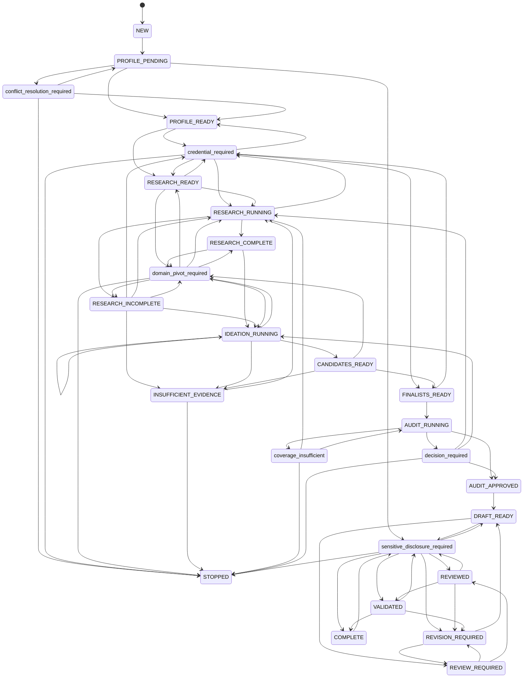
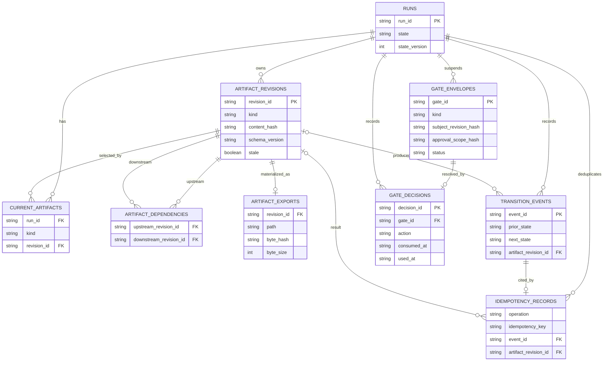

# Transactional State, Artifact DAG, and Gates

The workflow kernel is the authoritative boundary for a run. It combines the `StateStore` state machine, the SQLite schema and migrations, immutable revision history, dependency invalidation, export registration, idempotency records, and gate decisions. Higher-level workflows supply validated domain content; they do not get to update state, current pointers, approval records, or exports independently.

This page describes the shared mechanisms. For profile intake, retrieval, audit interpretation, and report content, follow the linked workflow pages at the end.

> **Safe ownership rule.** Use the workflow entrypoints and `StateStore` APIs, not direct SQL against the run database, direct replacement of an artifact file, or a hand-authored state change. In particular, a replay record is not permission to reuse a stale revision, and no normal state transition may enter or leave a mandatory gate state without the gate protocol.

## What is authoritative

A run has one mutable snapshot: `runs.state`, its monotonically incremented `state_version`, and a set of `current_artifacts` pointers. Everything else is retained evidence of how that snapshot was reached:

- `artifact_revisions` keeps canonical content, its semantic hash, schema version, creation time, and a stale flag.
- `artifact_dependencies` makes revision inputs explicit, so freshness is a directed acyclic graph rather than an assumption about timestamps.
- `transition_events` records actor, prior and next state, reason, evidence hashes, optional produced revision, and time.
- `idempotency_records` binds an operation and key to its event, result revision, and resulting state.
- `gate_envelopes` and `gate_decisions` capture a paused operation, the exact subject and approval scope, and the decision lifecycle.
- `artifact_exports` binds a revision to the path, SHA-256 byte hash, and byte count of its immutable materialization.

`run_status` and `run_show` provide supported read views of the current snapshot and artifacts. `connect_read_only_database` is also deliberately read-only and refuses an out-of-date schema; opening the normal connection is what runs migrations and integrity checks. Treat the database as the private authority, not as a file to repair by ad hoc updates.

### Workflow ingress and kernel APIs

`start_run()` is the canonical bootstrap: it verifies that the supplied profile export equals the authoritative profile database and is `profile_ready`, creates or replays the directory-scoped run, moves it through `profile_pending` and `profile_ready`, then publishes a hash-bound `profile_context` artifact while entering `research_ready`. Subsequent workflow modules use `add_revision()`, `transition()`, `publish_transition()`, and the gate APIs according to whether they only retain a revision, change state, materialize an output, or pause for authority. The kernel derives identifiers, event evidence, and current pointers; callers provide content, dependency IDs, actor, reason, operation, and idempotency key.

## Run lifecycle and mandatory pauses

`RunState` enumerates the lifecycle, while `ALLOWED_TRANSITIONS` is the legal-edge table. The diagram is a condensed rendering of those edges; it deliberately shows the gate states as separate destinations. `CANCELLED` is a special direct cancellation allowed from a nonterminal state and is described below rather than drawing an edge from every node.



This is the policy-owned run lifecycle. Gate aliases identify mandatory states, while the `AUDIT_RUNNING` to `COMPLETE` portion highlights the audit-to-release path.

### Gate protocol

The gate states are not ordinary waypoints. `transition()` and `publish_transition()` reject a direct transition **to** any gate state. They also reject a direct exit from a gate state, except cancellation. A gate must be raised with `suspend_gate()` or `publish_gate_transition()`, then decided with `decide_gate()` or, for artifact-producing audit decisions, `publish_gate_resolution()`.

| Gate kind | Mandatory state | Allowed actions | Policy-owned result |
| --- | --- | --- | --- |
| `conflict_resolution` | `conflict_resolution_required` | `choose_source`, `choose_value`, `retain_unresolved`, `stop` | Returns to the recorded suspended state unless stopped. |
| `credential` | `credential_required` | `configure_and_verify`, `approve`, `degrade`, `stop` | Returns to the recorded suspended state unless stopped. |
| `sensitive_disclosure` | `sensitive_disclosure_required` | `approve`, `redact`, `stop` | Approval returns to the recorded state; redaction goes to `draft_ready` or, for a post-review subject, `revision_required`. |
| `domain_pivot` | `domain_pivot_required` | `approve`, `reject`, `stop` | Returns to the recorded suspended state unless stopped. |
| `coverage` | `coverage_insufficient` | `expand`, `retry`, `stop` | `expand` restarts research and `retry` returns to the audit. |
| `excessive_similarity` | `decision_required` | `retain_with_warning`, `refine`, `replace`, `stop` | Respectively approves the audit, returns to ideation, restarts research, or stops. |
| `post_audit_checkpoint` | `decision_required` | `approve`, `re_ideate`, `re_research`, `stop` | Respectively approves the audit, returns to ideation, restarts research, or stops. |

The caller chooses an allowed action, never a target state. `gate_action_target()` owns that dispatch. `COMPLETE`, `STOPPED`, and `CANCELLED` are marked terminal for cancellation purposes, but `COMPLETE` can still be suspended into the sensitive-disclosure gate for an approved external share. That exception does not make a completed run freely mutable.

## Persisted provenance model



The diagram shows the core workflow tables. The database also persists profile ingestion/conflict information and research retrieval provenance; those records feed workflow artifacts but do not replace the revision DAG as the source of current run inputs.

### Schema ownership and migration behavior

`SCHEMA_VERSION` is currently `7`. `connect_database()` enables foreign keys, bounds SQLite's busy timeout, migrates from the stored `user_version` inside `BEGIN IMMEDIATE`, commits the entire sequence or rolls it back, then runs `PRAGMA quick_check`. It rejects a future or invalid schema version rather than attempting a downgrade. The current migration sequence introduced the state/DAG/gate tables, export registry, decision single-use columns, research provenance tables and later additive fields, and durable profile-conflict resolutions.

For an operational read path, `connect_read_only_database()` requires the exact current schema, enables `query_only`, and performs the same integrity check without migration. A write contender that cannot acquire the immediate transaction lock is surfaced as retryable `RunBusyError`, rather than leaking a database path or a raw SQLite busy error.

## Immutable revision DAG

### Identity and activation

Revision identity is semantic, not merely a hash of visible content. Before insertion, the kernel canonicalizes content and computes the content hash over all three inputs:

```text
content + sorted dependency revision IDs + schema version
```

The resulting revision ID is also scoped by run and artifact kind. Thus the same body with a new schema version or a different dependency set is a different revision. Repeating the exact same active revision reuses it; it does not create a second mutable copy. A revision that was already invalidated cannot be silently revived as an idempotent result.

`current_artifacts` is only a pointer per `(run_id, kind)`, not a rewrite of history. Adding a replacement pointer preserves the old revision, then invalidates its downstream descendants. Dependencies must belong to the same run, be non-stale, and not introduce a cycle.

### Recursive invalidation is the freshness rule

When a current artifact is replaced, `_invalidate_from()` traverses `artifact_dependencies` recursively from the prior revision. Every descendant is marked stale and loses its current pointer in the same transaction. The kernel also marks decisions for the affected subject hashes stale and supersedes matching pending envelopes. Consequently, a changed profile, evidence set, finalist, corpus, feature map, or scorer configuration invalidates downstream audit, decision, draft, review, and validation products rather than allowing an old approval to bless new inputs.

This is why an idempotency key is only a retry key. A prior `idempotency_records` result is returned only when its revision remains current and non-stale. If invalidation has occurred, replay fails with `StaleRevisionError`; the workflow must produce a new revision and, where required, obtain a new gate decision.

## Atomic transitions, events, and exports

All logical state mutations use `immediate_transaction()`. A successful transition can add a revision and dependencies, activate its current pointer, write the audit event, increment the run state version, and persist an idempotency record as one SQLite transaction. Fault injection points in the implementation deliberately exercise rollback between those boundaries.

`publish_transition()` and `publish_gate_transition()` add an immutable filesystem export to that flow:

1. Under the SQLite writer transaction, the kernel first validates the state and gate rules and checks for a valid idempotent replay.
2. It publishes bytes to the deterministic revision path using a same-directory temporary file, file `fsync`, no-clobber hard link, owner-only permissions, and directory `fsync`.
3. It records the revision, export registry row, current pointer, event, state, and idempotency row before committing the database transaction.

The semantic revision hash and exported byte hash are intentionally distinct: the former includes schema version and dependency IDs, while the latter attests to the materialized bytes. An existing target with identical bytes is safely reused; differing bytes at the same immutable path are an `ArtifactError`.

This is not a distributed transaction that can erase a filesystem object after a later database rollback. If a failure occurs after a completed no-clobber export but before database commit, the authoritative database rolls back and an unregistered immutable file can remain. On construction with configured export directories, `StateStore` holds the writer lock while recovery removes private temporary files, verifies registered exports by byte hash and size, and removes unregistered supported `ar_` exports. Do not replace or delete such files manually to simulate recovery.

Export paths are constrained to configured directories within a symlink-free workspace. The target and its ancestors are checked for symbolic links and file type safety. These checks, together with owner-only file permissions, make artifact publication an integrity boundary as well as a durability boundary.

## Idempotency: replay is not freshness

The idempotency key is unique per run and operation. On a completed retry, the kernel returns the original event, snapshot, artifact, and registered export without re-executing the payload or publishing a changed payload with the same key. Concurrent same-key publish attempts therefore converge on one winner.

That behavior has two strict limits:

1. The replayed artifact must still be current and non-stale. An idempotency record never overrides DAG invalidation.
2. A replay does not waive gate checks for a new operation. It can only return the exact already-recorded operation result; a different idempotency key needs its own valid authorization when the operation is gated.

## Exact-scope gates and single-use approvals

A gate envelope records the gate kind and state, suspended state and operation, exact subject revision hash, canonical approval scope and its hash, return state, and status. SQLite has a partial unique index that permits only one `pending` envelope per run. `suspend_gate()` requires the subject to be current and requires `return_state` to equal the exact state that was suspended.

Decision inputs are matched to the envelope's full subject hash and scope before a decision is created. `resolve_gate()` uses the gate's own kind to choose the expected input schema, rejects an input whose `approval_scope` differs from the stored canonical scope, and rechecks that the subject remains current. For the audit gates, resolution additionally binds current audit, finalist, corpus, feature-map, and scorer-configuration hashes; the checkpoint validates its complete finalist bindings and requires feedback for every current finalist. The decision artifact is then exported, registered, recorded, and transitioned atomically through `publish_gate_resolution()`.

A decision is an authorization only when its action is listed in `AUTHORIZING_GATE_ACTIONS`. `consume_decision()` checks the exact suspended operation, subject hash, and scope hash and records `consumed_at`. The subsequent guarded transition or publication atomically claims `used_at` and `consumed_by_event_id` only if they are still unset. This makes the approval single-use even under concurrent calls. A retry with the same idempotency key can return the already completed guarded result; a different operation or a distinct-key reuse is rejected.

Sensitive-disclosure approval demonstrates the difference between a decision and an actual release. An external share from `COMPLETE` constructs a scope that binds report, review, validation, recipient, destination, purpose, sensitive fields, and rendered-content hash. It suspends for approval, consumes an exact `approve` decision, and publishes a share receipt and markdown export with that decision claim in the same workflow transaction. A `redact` action is not share authorization; it produces a new report revision and sends the work back through drafting or revision.

## Audit-to-release control flow

The high-value path after candidate selection is intentionally evidence-bound:

1. Audit retrieval and scoring derive `corpus_set`, `feature_map_set`, and `audit_batch` revisions from current finalist and scoring inputs.
2. Final audit publication uses `publish_gate_transition()` to export the audit batch and raise either `coverage` or `post_audit_checkpoint`. The scope contains the relevant current hashes and finalist bindings. The checkpoint is used for both a clean audit and a decision-required audit; coverage is raised only when there is no `decision_required` result.
3. A checkpoint resolution can approve, send work back to ideation, or send it back to research. Approval reaches `audit_approved`, after which report publication may create `draft_ready`.
4. Review binds the current report hash and sends the run to `reviewed` only for an approved disposition; otherwise it moves to `revision_required`. Validation publishes a manifest dependent on the exact report and review and either returns to revision or reaches `validated`.
5. Before `COMPLETE`, the kernel independently requires current `report-v1`, `review-v1`, and `validation-v1` artifacts; recomputes deterministic validation; verifies approved review/report bindings; and verifies the required report-to-review-to-validation dependency edges.

The reporting, review, validation, and sharing components define their content contracts, but the kernel is the final enforcement point for state order, freshness, completion, and release authorization.

## Extension and operational guidance

When introducing a workflow stage or artifact, preserve these boundaries:

- Add lifecycle behavior through `RunState`, `ALLOWED_TRANSITIONS`, and, if human authority is needed, `GateKind`, `GATE_STATES`, `GATE_ACTIONS`, and `gate_action_target()`. Do not model a gate as an ordinary direct transition.
- Give a changed artifact format a distinct `schema_version` and enumerate every input revision as a dependency. Do not rely on a display field or a timestamp to establish freshness.
- Use a publishing API only with a validated, configured export directory. It creates the registry, event, state, and replay record together; a standalone file write cannot substitute for it.
- Add database changes through the versioned migration sequence. Migration code must retain the all-or-nothing transaction, forward-version refusal, and post-migration integrity check.
- Treat `RunBusyError` as a bounded, retryable contention outcome. Treat `DatabaseCorruptError`, an export-hash mismatch, an unsafe path, or a stale revision as an integrity failure requiring investigation and a supported recovery path, not a request to edit tables or artifacts in place.

## Focused verification

The integration tests are the most useful executable specification for this kernel:

- `tests/integration/test_g002_transactional_state_kernel.py` verifies migration rollback and future-version rejection; every declared state edge and gate bypass rejection; recursive invalidation; revision identity changes caused by schema or dependency changes; fault rollback; bounded writer contention; hash/scope gate matching; and stale replay rejection.
- `tests/integration/test_g002_invalidation_dag.py` mutates each important upstream in a representative profile-to-validation graph and asserts that decision, draft, review, and validation descendants become stale and lose current pointers.
- `tests/integration/test_g002_publish_register_integration.py` injects failures before and after export publication, confirms database rollback while a post-publish file may remain for recovery, checks registry hashes and replay behavior, races same-key publishers, and races reuse of a consumed approval so exactly one guarded publication wins.

## Related documentation

- [System overview](/openwiki/architecture/system-overview.md)
- [Privacy and authority boundaries](/openwiki/concepts/privacy-and-authority-boundaries.md)
- [Reliability, recovery, and release evidence](/openwiki/operations/reliability-recovery-and-release-evidence.md)
- [Verification strategy](/openwiki/testing/verification-strategy.md)
- [Profile and run bootstrap](/openwiki/workflows/profile-and-run-bootstrap.md)
- [Similarity audit and human checkpoint](/openwiki/workflows/similarity-audit-and-human-checkpoint.md)
- [Report review validation and sharing](/openwiki/workflows/report-review-validation-and-sharing.md)
