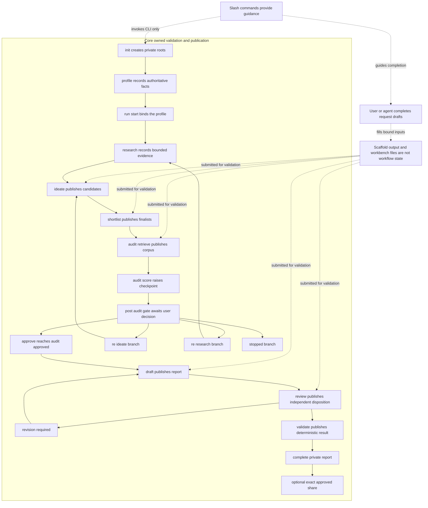

AI Patent Factory is a **local-first, evidence-bound workflow** for organizing an inventor's material and researching similarity within retrieved corpora. The architectural center is the local Python command-line interface, `python3 -m patent_factory`: it owns state transitions, validation, gate decisions, invalidation, idempotency, and publication. The Claude Code slash commands are the recommended human/agent interface, but they are guides around that CLI rather than an alternative authority.

This division is intentional. A wrapper can explain the next step, invoke a CLI command, and help a user complete a request file. It must not edit SQLite, exports, state pointers, or invent an approval in order to make the workflow advance. The raw CLI remains the automation and debugging entrypoint when slash commands are unavailable.

> **Scope and legal limit:** Reports organize inventions and record evidence-bound similarity research. A similarity score applies only to the retrieved corpus. Neither the workflow nor its wrappers determine patentability, novelty, inventive step, validity, non-infringement, freedom to operate, or any other legal conclusion.

## Runtime at a glance

There are three distinct planes:

| Plane | Responsibility | What it must not do |
| --- | --- | --- |
| **Guidance plane** | `/setup`, `/research`, `/ideate`, `/shortlist`, `/audit`, `/checkpoint`, `/draft`, and `/review` explain inputs, invoke the CLI, surface its JSON result, and stop at gates. | Mutate workflow state directly, edit an export or database, choose a gate action, or treat an agent-generated narrative as evidence. |
| **Core plane** | The `patent_factory` CLI validates paths and request schemas, operates the state machine, writes SQLite records, binds hashes, exports artifacts, and performs deterministic validation. | Treat a copied file, a wrapper assertion, or a chat-session decision as an authoritative state transition. |
| **Boundary plane** | Private filesystem roots, explicitly selected adapters, and the guarded external-share operation delimit data at rest and data leaving the run. | Turn local execution, use of a hosted agent, or a configured credential into blanket permission for egress. |

This is the normal stage progression. Dotted edges are guidance and request preparation; they do **not** publish a workflow artifact or change run state. Solid edges are core-owned validation and publication. Other gate outcomes—such as profile conflicts, credentials, domain pivots, insufficient evidence, thin audit coverage, review revisions, and sensitive disclosure—hold the run at their specific state until the core accepts an exact decision or a permitted corrective branch.

## Entrypoints and authority

### Slash commands are procedural wrappers

The eight slash-command documents are a conversational operating procedure. For example, `/setup` selects an input mode and reports the CLI's status; `/research` starts a run and chooses one bounded collection method; `/checkpoint` re-reads the pending gate and has the user complete its decision input. They make the normal path discoverable, including where to put files and when to stop.

Their role is deliberately narrower than “agent automation” might suggest:

- A command can invoke a mutating CLI verb, but the **CLI** decides whether the verb is legal in the current state and performs the resulting mutation.
- A command can call `scaffold` to make a hash-bound request draft and help the user fill fields. The draft is input, not authority. A core stage verb must still validate it and publish any accepted artifact.
- The ideation workbench is an especially important boundary. Raw ideas, sessions, relations, clusters, and notes under `workspace/requests/ideation/RUN_ID/` are non-authoritative. Only a validated promoted candidate input submitted to `ideate` can publish candidates.
- On `*_required`, `coverage_insufficient`, `decision_required`, `insufficient_evidence`, `revision_required`, `stopped`, or `error`, a wrapper preserves the result identifiers and stops. These statuses are not a prompt to retry creatively, bypass the gate, or fill a user judgment field.

This makes the CLI a stable interface for both guided use and scripted use. It also means that a hosted model is not implicitly trusted with private state merely because it is helping operate a local repository.

### The public CLI result envelope

Except for `--help` and `--version`, every invocation—including bad or missing arguments—writes **one JSON object** to standard output. The CLI adds these stable envelope fields:

- `schema_version: "cli-result-v1"` and `envelope_version: "cli-envelope-v1"`;
- `command`, `started_at`, `ended_at`, `prior_state`, `next_state`, `artifact_ids`, and `event_ids`;
- `run_id` when supplied; and
- `failure_code`, which is `null` for a handled result and classifies an enveloped error otherwise.

Consumers should parse this object rather than scrape prose or infer state from output files. In particular, a successful process exit does not mean that the whole workflow is complete, and a nonzero exit does not necessarily mean an implementation failure: several nonzero codes communicate an expected gate or a safe incomplete outcome.

| Exit code | Meaning at the CLI boundary | Operator action |
| --- | --- | --- |
| `0` | The invoked operation completed or safely replayed its stored result. | Read `status` and `next_state` for the next supported stage. |
| `2` | Argument, path, input, state, I/O, or runtime error was caught and enveloped. | Read `failure_code`; correct the stated condition rather than editing state. |
| `3` | Profile ingestion found conflicting facts. | Inspect the exact conflict batch and obtain a user decision. |
| `4` | Research ended incomplete rather than with a complete evidence result. | Preserve the adapter limitation and choose a supported follow-up. |
| `5` | A KIPRIS/audit credential gate is required, or shortlist reports `insufficient_evidence`. | Stop; handle the returned gate or preserve insufficiency. |
| `6` | Ideation requires a domain-pivot decision. | Obtain the exact decision before resuming. |
| `7` | Audit coverage is insufficient. | Do not score it as cleared; resolve the coverage branch. |
| `8` | `audit score` raised `decision_required`. This is the normal result of every audit score, including a clean one. | Run `/checkpoint`; do not draft directly. |
| `9` | An external share needs sensitive-disclosure approval. | Present the exact recipient, purpose, content, and fields for a user decision. |
| `10` | Review requires revision. | Return to drafting; do not call `validate`. |
| `11` | `delete-run` finished with a partial failure report. | Preserve and remediate the reported cleanup failure. |
| `12` | SerpApi quota exhaustion was confirmed. | Use the emitted manual-import template; do not fabricate results. |
| `13` | The SerpApi credential gate is required. | Decide the exact credential gate before a live retry. |

The status field remains the primary semantic signal. For example, the same code `5` has intentionally different meanings for different stage results, and the envelope names the command and state needed to distinguish them.

## Private roots, profile authority, and runs

### Two owner-only roots

`python3 -m patent_factory init` establishes two local roots, normally `documents/` and `workspace/`, and creates them with owner-only directory permissions. `documents/` contains user-provided source material and request imports; `workspace/` contains generated state, profile exports, stage inputs, and per-run artifacts. The initial `workspace/requests/` directory is where versioned request files are kept.

The path policy is fail-closed:

- command paths must be relative, may not traverse through `..`, and reject symbolic-link components;
- inputs and outputs must remain under their appropriate configured private root;
- private directories are enforced as `0700` and generated private files as `0600`; and
- each run is a contained directory below the workspace root, not the workspace root itself.

As a result, the core does not accept an arbitrary absolute database, source, export, or run path just because a wrapper provides it.

### Authoritative profile and per-run database

Profile ingestion accepts a folder, one document, or interview responses and writes the authoritative profile facts and provenance into `workspace/profile.sqlite3`. `profile.json` is a deterministic export, not a second editable source of truth. If incoming facts conflict with current facts, ingestion records the conflict and reports `conflict_resolution_required` rather than silently choosing a value.

`run start` creates a private run directory and a distinct `factory.sqlite3` for that run. Before it starts, the core compares the supplied profile export canonically to the profile database and requires a current, conflict-free `profile_ready` profile. It then records an immutable `profile_context` binding and advances the new run through `profile_pending` and `profile_ready` to `research_ready`. Repeating the same start is an idempotent replay rather than a second run bootstrap.

The profile database and the run database therefore serve different purposes:

- **profile database:** inventor facts and fact-level claims, conflict state, and the authoritative profile revision;
- **run database:** the state machine, artifacts and dependencies, evidence/retrieval records, gates and decisions, idempotency coordinates, transition events, and export registry for one run.

Use `run status` for the current state and artifact hashes and `run show --kind KIND` for the body of a current artifact. These are the supported inspection surfaces; do not query the database by hand to reconstruct or modify workflow state.

## Lifecycle, gates, and publication

### State transitions are core policy

The core enumerates legal `RunState` transitions from bootstrap through research, candidates, finalists, audit, report, review, validation, completion, and terminal stopping. A transition is not merely an assignment: it is recorded with an actor, reason, evidence hashes, and an idempotency key. The store uses immediate SQLite transactions so a failed state mutation does not leave a partial transition record.

Gate states are mandatory boundaries. The state store rejects direct entry to a gate state without a gate envelope and rejects direct exit from a gate state without a core decision. One run may have only one pending gate. Each envelope records the suspended operation and state, the current subject artifact hash, a hashed approval scope, and a return state; decision input must match those bindings exactly. The core, not the wrapper, maps each allowed action to its legal target state.

Changing an upstream current artifact invalidates all dependent artifact revisions through the dependency graph. It also marks decisions based on affected subject hashes stale and supersedes pending gates for those hashes. This is why an old `decision_id`, a copied approval input, or an approval for a previous report cannot authorize new content.

### Stage semantics

1. **Profile and research.** A ready profile is bound into a fresh run. Research persists bounded fixture, manual-import, or explicitly live-adapter results and can report incomplete coverage rather than treating an adapter failure as evidence.
2. **Ideation and shortlist.** The core accepts only evidence- and profile-bound candidate input, then accepts three independently scored finalists or persists the explicit `insufficient_evidence` outcome. It does not manufacture a shortlist from one or two weak candidates.
3. **Audit and checkpoint.** Finalist-specific retrieval produces the audit corpus, then `audit score` evaluates the sealed feature maps. Every score—whether coverage is sufficient and whether risk is low or high—raises the `post_audit_checkpoint` gate. The user supplies one `approve`, `re_ideate`, `re_research`, or `stop` action; those branches lead respectively to `audit_approved`, ideation, research, or `stopped`.
4. **Draft, review, validate.** Drafting requires `audit_approved` or a documented revision path and publishes the rendered report. Review must bind the current report hash and uses a reviewer identity and pass different from the drafter. An approved review reaches `reviewed`; a revise disposition reaches `revision_required`. Only `validate` from `reviewed` runs deterministic checks, publishes validation, and can transition the run to `complete`.
5. **Optional share.** Sharing comes after the private report is complete and is a separate operation, not a file-copy shortcut.

The audit checkpoint is particularly easy to misread: `decision_required` and exit `8` after scoring are expected control flow, not an audit that the wrapper should auto-approve. Likewise, review exit `10` means revision is required; validation is intentionally unavailable until review has succeeded.

## SQLite-backed provenance and immutable artifacts

SQLite is not a cache that may be reconstructed from exports. It is the transactionally updated record of the current run. Its schema holds state snapshots, immutable `artifact_revisions`, current-artifact pointers, dependency edges, transition events, idempotency records, gate envelopes/decisions, export metadata, and research observations/evidence. Database opening enables foreign keys, migrates only supported schema versions, runs an integrity check, and enforces owner-only database permissions.

Artifacts are revisions, not mutable “latest files.” Their identity hashes the canonical content, schema version, and exact upstream revision IDs. The store maintains the current revision per artifact kind, rejects stale revisions as dependencies, detects dependency cycles, and invalidates descendants when an upstream current revision is replaced. A matching idempotency coordinate returns the original current result; it does not publish another revision.

Publication has a paired filesystem and database protocol:

1. the core serializes the artifact deterministically and writes it as an owner-only immutable export using a same-directory temporary file, `fsync`, and no-clobber link publication;
2. within the state transaction it registers the exact path, byte hash, and byte size, records the artifact/dependencies/event/idempotency entry, and changes the run state; and
3. on later store construction, export recovery removes safe temporary or unregistered residue and verifies registered bytes before further publication.

The resulting `ar_...` exports are evidence of a particular revision. They are not a supported way to alter the state machine. A copied or edited export cannot replace the registered artifact, nor can it satisfy a gate binding.

## External service and sharing boundaries

### Local by default

The core's standard fixture, normalization, manual import, profile, state, report, review, and validation paths are local. `research normalize-web` transforms an already supplied `web-rows-v1` file locally, and `research manual` validates a user-provided import against an explicit HTTPS host allowlist; neither command independently fetches the web.

The local CLI also does not authorize a driving agent to put source text, profile values, workspace content, or secrets into a hosted model context. Hosted Claude Code, Codex, and similar services are external processors. An exact, current approval and a minimized egress manifest are required outside this workflow contract before such a transfer.

### Opt-in live adapters

The only credentialed network operations are:

| Operation | Remote boundary | Required controls |
| --- | --- | --- |
| `research kipris` | KIPRIS Plus at `plus.kipris.or.kr` | `KIPRIS_PLUS_API_KEY`, bounded query planning/budgets, HTTPS host binding, and a current credential decision when required. |
| `audit retrieve --live` | KIPRIS Plus at `plus.kipris.or.kr` | The same KIPRIS credential and a decision binding the exact audit request. |
| `research serpapi` | SerpApi at `serpapi.com` for Google Patents search and quota preflight | `SERPAPI_API_KEY`, locally validated run state and credential approval before a fresh authorized request, and bounded query parameters. |

Credentials are read from environment variables and are protected by canary checks/redacted error handling; the contract is that keys are not persisted or logged. Query envelopes bind the adapter/version, HTTPS host, budgets, projection, and—when used for audit—finalist-specific audit bindings. The binding remains stored for provenance while adapters receive only the query projection needed for their request.

A SerpApi quota stop is a deliberate safe failure. When quota exhaustion is confirmed, the core records a `research_quota_stop` artifact and creates or preserves a manual-import template under the documents root. A transient rate limit is reported as incomplete research unless the account endpoint confirms exhaustion; it is not converted into invented evidence or a fabricated quota state.

### Sharing is an explicit egress operation

`share` is not an adapter call and does not become allowed simply because a report is complete. It requires an `external-report-share-v1` input that binds the current report hash, destination, recipient, purpose, and the exact sorted sensitive-field set. The core verifies the current report, approved review, and validation artifacts; then it raises a sensitive-disclosure gate if there is no matching current approval.

After an exact approved decision, the core writes the Markdown under a managed owner-only `.patent-factory-shares` subdirectory outside the private run and publishes a hash-bound share receipt. The receipt depends on the report, review, and validation revisions. A changed report, destination, recipient, purpose, or sensitive-field set cannot reuse the prior approval.

## Operating and change guidance

- Initialize roots with `python3 -m patent_factory init`; keep inputs under `documents/` and generated state under `workspace/`.
- Let the CLI create, inspect, and remove state. Use `run status`, `run show`, `gate inspect`, and `delete-run`; do not repair runs with SQL, file moves, database deletion, or exported-file edits.
- Treat every `gate_id`, `subject_revision_hash`, `approval_scope`, and returned `decision_id` as an exact capability, not a general approval. Resume only the suspended command and current input the core authorizes.
- Extend workflow behavior by adding a validated core operation, state transition, artifact schema/dependencies, and tests. Adding a slash-command paragraph alone changes guidance, not authority.
- Keep adapter extensions bounded: define their request envelope, host/scheme controls, credential policy, result/failure normalization, persistence behavior, and gate semantics before exposing them through a wrapper.

### Focused verification

The most useful regression tests for this architectural contract are:

- `tests/integration/test_g008_cli_core.py` checks the one-object CLI envelope, plain help/version exception, run bootstrap replay, private permissions, safe deletion, and redacted failures.
- `tests/integration/test_g002_transactional_state_kernel.py` exercises the allowed-transition table, mandatory gate API, immutable revision identity, dependency invalidation, idempotency, migrations, and transaction-fault rollback.
- `tests/integration/test_g010_checkpoint.py` and `tests/integration/test_g011_ideation_workbench.py` cover the always-raised checkpoint branches and the separation between workbench validation and candidate publication.
- `tests/integration/test_g003_serpapi_cli.py`, `tests/integration/test_research_reentry_guard.py`, and `tests/integration/test_research_manifest_stage_scope.py` cover live-research credential, quota, and re-entry boundaries.
- `tests/integration/test_g007_report_review_validation.py` covers report/review/validation lifecycle behavior; `tests/integration/test_g005_atomic_gate.py` covers atomic gate publication.

For detailed persistence and provenance mechanics, see [State and Provenance Kernel](/openwiki/architecture/state-and-provenance-kernel.md). For the policy view of transfer and authority, see [Privacy and Authority Boundaries](/openwiki/concepts/privacy-and-authority-boundaries.md). Operational command examples are in [CLI Private Workspace and Scaffolds](/openwiki/operations/cli-private-workspace-and-scaffolds.md), while stage-level procedures are linked from [Quickstart](/openwiki/quickstart.md).
