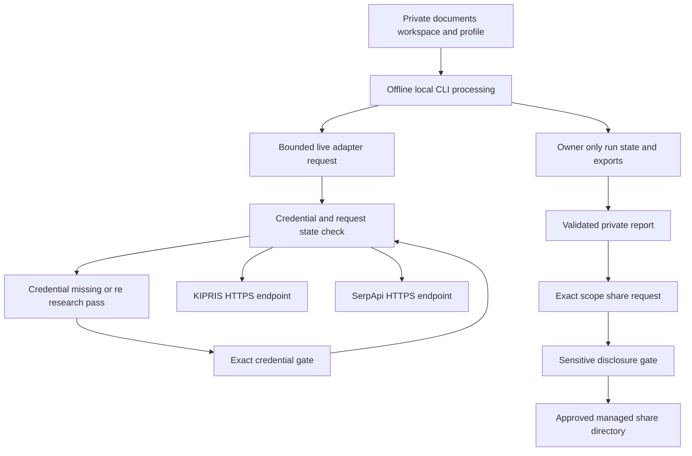

The project is **local-first, not permissionless**. Private material may be processed by the local Python core, but that does not authorize a wrapper, a chat session, a hosted model, a network adapter, or an external recipient to receive it. The `patent_factory` CLI is the only authority that can change workflow state, consume a decision, invalidate an artifact, or publish an export. Slash commands and other agents guide a user through CLI inputs and surface results; they must not edit SQLite state, deterministic exports, or gates directly.

This page defines the boundary around that authority. It is deliberately stricter than a convention: path validation, state gates, hash bindings, permission checks, and canary checks make unsafe paths fail rather than silently widening access.

## Safety model at a glance

This flow distinguishes local processing from the two narrow outbound paths: documented adapters egress bounded query data plus a process-only credential, while `share` writes a completed report externally only after approval of that report's exact disclosure scope.

## Private data and authority

### What stays local

`documents/` is the private input area for inventor background, notes, interview responses, fixtures, and manually supplied research material. Other than `documents/README.md`, its contents are git-ignored. `workspace/` holds the authoritative profile database (`profile.sqlite3`), its deterministic `profile.json` export, request inputs, and per-run databases and exports. The profile database—not a hand-edited export or an agent narrative—is authoritative.

Treat all source text, profile values, request files, workspace artifacts, and environment secrets as private. In particular:

- **Documents, workspace, and profile data must not be sent to hosted-model context without a current, minimized approval.** Claude Code, Codex, and similar hosted systems are external processors; merely using them to operate the repository is not approval to disclose local content.
- A model or wrapper may help formulate an input, but may not invent an approval, a decision ID, a reason, or an approval scope. It must stop and preserve the core result when a gate or safe incomplete status is returned.
- The ordinary CLI pipeline is offline. It reads local material, computes artifacts and hashes, and persists state locally. It does not turn a local file into a network payload.
- Never put credentials in `documents/`, request files, reports, chat, or copy-pasted command output. Keep the supported credentials in the process environment.

The core exposes a generic hosted-call guard for an integration that is explicitly approved. It requires a current `EgressApproval`, checks that the subject revision, recipient, model class, purpose, and scope all match, requires the requested data classes to be within the approved set, checks the payload for credential canaries, and creates an `EgressManifest` containing the relevant content hashes. This is a control surface, not blanket authorization: an integration must still use a current, minimized approval for the concrete transfer.

### Filesystem containment and owner-only modes

Private roots are intentionally relative to the process working directory. The path policy rejects absolute paths and `..` traversal, examines every existing component with `lstat`, and rejects any symbolic link in the path chain before resolving it. It then proves that resolved inputs, outputs, and nested run directories remain under their configured trusted root.

`init` creates or hardens `documents/` and `workspace/` as owner-only directories (`0700`). A run directory created beneath the workspace receives the same mode; failure to set or verify the mode is a `PathPolicyError`, rather than a best-effort warning. Writers that create request, normalized-import, or recorded-response files set those private files to `0600`. Inputs must be the expected regular file or directory, and outputs require an existing contained parent and a regular-file target when one already exists. These checks prevent traversal, symlink substitution, and accidental writes outside the private workspace.

The same posture applies to cleanup. `delete-run` accepts one contained run beneath the workspace, rejects a symlink workspace/run chain and the workspace root itself, unlinks symlink entries instead of following them, and reports per-path failures. Do not delete a database, export, log, or run directory by hand: direct deletion can bypass state/cleanup expectations or affect an unintended sibling.

## Credentials, canaries, and bounded query egress

### The only documented live routes

Only three CLI routes perform opt-in network egress:

| Route | Destination and transmitted request data | Credential | Local safeguards |
| --- | --- | --- | --- |
| `research kipris` | `plus.kipris.or.kr`; planned keyword or bibliography parameters, bounded by query, result, call, byte, and page limits | `KIPRIS_PLUS_API_KEY` | Query envelope host/scheme validation, exact credential handling, no redirects outside the allowlist |
| `audit retrieve --live` | `plus.kipris.or.kr`; finalist-specific bounded KIPRIS query envelopes | `KIPRIS_PLUS_API_KEY` | Same KIPRIS adapter and credential boundary |
| `research serpapi` | `serpapi.com`; bounded keyword, country, page, and result parameters; optional quota preflight uses the same credential | `SERPAPI_API_KEY` | Local run/state validation precedes preflight and search; replay does not make a new request |

Only these documented live adapter routes may egress bounded request data and process-only credentials. Fixture, manual import, `research normalize-web`, drafting, scoring, review, validation, and the rest of the local workflow do not send `documents/`, `workspace/`, or profile data over the network. `research normalize-web` is a local normalizer for externally gathered public metadata; the external gathering itself is not an implicit exception to the hosted-model approval rule.

The adapters construct a constrained `QueryEnvelope` before adding their credential. The KIPRIS adapter only accepts HTTPS to `plus.kipris.or.kr`; the SerpApi adapter only accepts HTTPS to `serpapi.com`. Both disable redirects and reject a final URL outside their corresponding allowlist. They add `ServiceKey` or `api_key` **after** request fingerprinting and do not return the key in an adapter result. Responses are byte-bounded, normalized to metadata, and raw provider responses are not cached or redistributed.

### Credential-gate lifecycle

A credential is not a general capability token. The research runner requires a credential-requiring adapter to declare its credential name, persists a hash-bound request revision, and makes a credential gate describe the target adapter, host, capability, request fingerprint, and—in a batch—the approved query count, effective pages, maximum requests, and result budget.

On an ordinary first pass with a configured credential, the adapter can execute its bounded request. If the credential is missing, or if the provider rejects it, the runner suspends at `credential_required` before proceeding and requires a decision bound to that request to resume. A credentialed `re_research` second pass is stricter: it force-raises a fresh gate even when the environment contains a key. The approval scope shows the bounded plan and literal second-pass terms, and a resume may not increase approved page or result ceilings. This prevents a decision for one request or pass from silently authorizing another.

`research serpapi` additionally validates the run and its state locally before its quota preflight. Stored successful results replay without network access. If account information confirms quota exhaustion at the configured threshold, the command records `quota_exhausted` and creates a contained manual-import template instead of fabricating evidence. A transient rate-limit response becomes a retryable incomplete outcome unless a subsequent account check actually confirms quota exhaustion.

### Secret handling and leak detection

The current credential registry is `KIPRIS_PLUS_API_KEY` and `SERPAPI_API_KEY`. `environment_secret` reads only valid uppercase environment variable names, while credential diagnostics expose only name/presence/status—not values. The registry also provides the actual configured values as runtime **canaries** for leak detection.

Before adapter results are persisted, the research store recursively scans records, failure information, coverage, rate-limit metadata, and notes for every configured credential canary. The same primitive protects multiple artifact-producing paths and the normalized web input path. A detected canary raises a redaction-safe error before persistence. The CLI also replaces configured credential values found in error messages with `[REDACTED]`; diagnostic mappings redact fields whose names indicate secrets or proprietary raw source material. When adding a credentialed adapter, update the credential registry and preserve these canary checks—otherwise the new credential is outside the repository-wide scrub boundary.

## External report sharing is a separate disclosure decision

A completed private report is not automatically shareable. `share` accepts only an `external-report-share-v1` request with a destination, recipient, purpose, current report hash, and sorted exact set of sensitive fields. The core requires a completed private report with valid current report, review, and validation artifacts. It verifies that the supplied report hash and sensitive fields exactly match the current report before it considers sharing.

On the first matching request, `share` constructs a sensitive-disclosure scope binding:

- the hash of report Markdown and current report/review/validation revisions;
- the destination, recipient, and purpose; and
- each disclosed field with its reason and text hash.

Without a decision, the run moves to `sensitive_disclosure_required` and returns the available actions: `approve`, `redact`, or `stop`. Approval must match the exact current scope and report subject hash; changing content, recipient, purpose, destination, or fields invalidates it. A successful approval is consumed once, although an identical completed share can replay its existing receipt rather than disclose again. `redact` returns the workflow to drafting with stale review/validation artifacts, and `stop` publishes no share.

The destination is itself constrained: it must be a non-symlink directory under the run's parent but outside the owner-only run. The core creates or validates its own `.patent-factory-shares` subdirectory, requires it to be owned by the current user and `0700`, publishes the Markdown report there, and records an `external-share-receipt-v1` artifact. Do not copy a private report around this gate; doing so loses the exact-scope decision and receipt trail.

## Legal and evidentiary limit

This system organizes invention material and records evidence-bound similarity research. It is **not legal advice** and must not state or imply a conclusion about **patentability, novelty, inventive step, validity, non-infringement, or freedom to operate (FTO)**. Similarity scores and retrieved references are research aids limited to the corpus actually retrieved; they do not establish legal status, claim scope, clearance, or outcome. A decision requiring such a conclusion belongs with a qualified patent attorney or agent.

## Operating and change checklist

1. Start with `python3 -m patent_factory init`; keep roots relative, private, and free of symlinks.
2. Use the CLI—not SQLite, export edits, direct file copies, or ad hoc scripts—for profile/run state, decisions, exports, sharing, and deletion.
3. For local work, keep private text in `documents/` and `workspace/`; do not paste it into a hosted-model prompt. For a truly necessary hosted transfer, obtain a current minimized approval and record the exact recipient, purpose, data classes, content hashes, and scope.
4. Keep adapter additions offline by default. A live extension needs an explicit allowlisted endpoint, bounded envelope, process-only credential, credential gate semantics, no-redirect handling, response bounds, and coverage by the known-credential canary boundary.
5. Exercise the safety-focused tests when modifying these boundaries: `tests/unit/test_privacy.py` covers hosted approval, canary rejection, redaction, deletion, and mode hardening; `tests/unit/test_credential_canaries.py` fixes the credential registry expectation; integration tests cover path failure, live research gates, SerpApi preflight/quota behavior, and exact-scope sharing.

See also [System overview](../architecture/system-overview.md) and [State and provenance kernel](../architecture/state-and-provenance-kernel.md) for the state-machine and artifact-binding mechanisms that make these boundaries enforceable.
