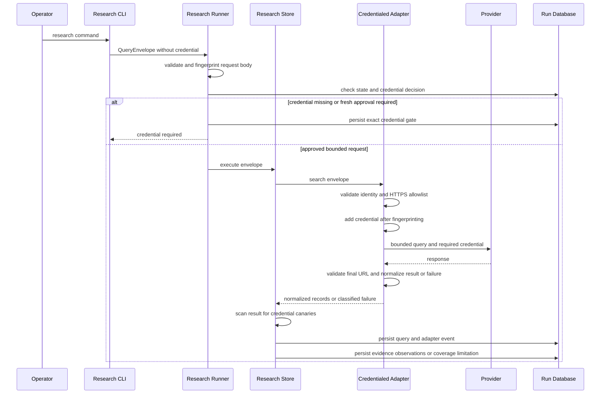

# Research Adapters and Network Egress

Research adapters convert a deliberately narrow `QueryEnvelope` into normalized evidence metadata or a classified failure. They are not general web clients: a credentialed adapter validates its identity, HTTPS destination, bounded projection, and response before research persistence can occur. The runner and `ResearchStore` supply the other half of the contract: exact-scope credential gates, idempotency, canary scanning, and transactional provenance.

This page covers the research-stage integrations. The state-machine meaning of `credential_required` and artifact publication is documented in [Transactional State, Artifact DAG, and Gates](/openwiki/architecture/state-and-provenance-kernel.md); privacy authority for any other external sharing is separate in [Privacy, Authority, and Legal Boundaries](/openwiki/concepts/privacy-and-authority-boundaries.md).

> **Egress invariant.** On a live route, the network payload consists only of the adapter's bounded query parameters and its required process credential. Raw private documents, profiles, audit bindings, and local artifacts are not network payloads. The adapter computes the request fingerprint before adding `ServiceKey` or `api_key`; keys are not returned in `AdapterResult`, and the store rejects an adapter response that contains a configured credential canary. Normalized adapter metadata, including literal KIPRIS status tokens, is research evidence—not a legal conclusion about patentability, validity, status, clearance, or any other legal outcome.

## Contract and control boundary

`SearchAdapter` is a small protocol: an adapter has a stable `name` and `version` and implements `search(envelope) -> AdapterResult`. `QueryEnvelope` is the durable request description. It has a run and adapter identity, one capability, an HTTPS allowed host, timeout, page/cursor and retry values, byte/result/page budgets, a query projection, and optional audit binding. Its canonical `request_body()` is fingerprinted to form `request_fingerprint`; the audit binding is retained and fingerprinted but adapters egress only fields derived from `query_projection`.

A successful `AdapterResult` carries records, a response hash, terms note, coverage, optional cursor and rate-limit data. A failure result has no records and uses one of the shared `AdapterFailureKind` values: `auth`, `timeout`, `rate_limit`, `access_denied`, `malformed`, `oversize`, `unsupported`, `network`, or `internal`. This gives the persistence and workflow layers a stable outcome vocabulary regardless of provider-specific response format.

### Adapter matrix

| Adapter | Entry points and allowed destination | Capability and bounded projection | Credential | Produced records and notable behavior |
| --- | --- | --- | --- | --- |
| `KiprisAdapter` (`kipris`, `plus-xml-v1`) | `research kipris` and live KIPRIS audit retrieval. Only `https://plus.kipris.or.kr` is accepted; the operational base is `https://plus.kipris.or.kr/kipo-api/kipi/patUtiModInfoSearchSevice`. | `word_search` accepts only `word`, `year`, `patent`, `utility`, and optional `num_of_rows`; `word` is required, `year` is 0–10, and rows are bounded by 500 and the result budget. `bibliography_summary` accepts exactly `application_number`. | `KIPRIS_PLUS_API_KEY`, inserted as `ServiceKey` only after fingerprinting. | `kipris_patent` records with `kr-patent:<normalized application number>` locators and KIPRIS provenance. The two capabilities select `getWordSearch` and `getBibliographySumryInfoSearch` respectively; bibliography lookup is one request per supplied application number. |
| `GooglePatentsAdapter` (`google_patents`, `serpapi-v1`) | `research serpapi`. Only `https://serpapi.com` is a live destination; its response may cite canonical `https://patents.google.com` record URLs. | `word_search` only. It requires `word` and admits only `word`, `num`, `country`, `language`, `status`, `type`, `before`, `after`, and `sort`; `num` is 10–100. It sends `engine=google_patents`, normalized query `q`, requested page, and JSON output. | `SERPAPI_API_KEY`, inserted as `api_key` only after fingerprinting. | `google_patent` records with `gpatent:<normalized publication number>` locators and `serpapi_google_patents` provenance. A source patent URL is retained only when it is a safe canonical Google Patents HTTPS URL; otherwise the adapter builds the canonical URL from the publication number. |
| `ManualWebAdapter` (`manual_web`, `import-v1`) | `research manual` consumes a local JSON file. `research normalize-web` converts agent-gathered public rows to that import shape locally. The caller supplies a non-empty host allowlist, and every record URL must be HTTPS on exactly one of those hosts. No adapter HTTP request is made. | `import` only, with exactly `content_type: application/json` and `records`. The closed record schema permits canonical URL, identifier, title, content hash, language, provenance, excerpt hashes, interpretations, and limitations. The normalizer accepts the smaller web-row schema and an explicit source tag from `arxiv`, `github`, `google_patents`, `naver`, `papers_with_code`, or `web`. | None. | `manual_web` records retain user-supplied, explicit provenance. The normalizer derives title/abstract/excerpt span hashes and a content hash locally, then emits records that must round-trip through the same import sanitizer. |

`research kipris --capability bibliography_summary --application-number <number>` is intentionally distinct from keyword planning: it does not accept `--query`, and the planner creates an exact application-number projection. This is useful when a previously observed KIPRIS application needs its bibliography metadata, not a new free-text search.

## Credentialed request sequence

This sequence shows the ordering for KIPRIS Plus and SerpApi calls: authorization and fingerprinting are local, and persistence receives normalized output rather than a credential-bearing request or raw provider payload.

### Allowlist and transport rules

The default KIPRIS and SerpApi transports disable automatic redirects, request only their expected XML or JSON media type, read at most `byte_budget + 1` bytes, and reject an oversized response. Even when a supplied transport reports `final_url`, each adapter requires HTTPS, its one allowlisted hostname, no userinfo or fragment, and only the default HTTPS port. A request whose envelope names the wrong host, a missing credential, or an invalid identity/capability fails before transport invocation.

This separation matters for record links: a SerpApi search may yield a Google Patents link, but that link is normalized as evidence metadata and is **not** a second network request. It is accepted only with HTTPS, `patents.google.com`, no credentials/userinfo/fragment, and port 443; otherwise a constructed canonical patent URL is used.

## Provider behavior and normalization

### KIPRIS Plus XML

KIPRIS requires an explicit application success indicator (`successYN=Y`), expected body and items structure, and valid pagination fields. Unsafe `DOCTYPE` or entity declarations and malformed XML become `malformed` rather than being parsed. Application error code `30` is normalized to `auth`; other application errors are malformed. HTTP 401/403 likewise map to `auth`, 429 to retryable `rate_limit` with available `X-RateLimit-*` and `Retry-After` metadata, timeouts to retryable `timeout`, and transport errors to retryable `network` where applicable.

For each item, application-number presentation punctuation is removed and case is normalized for the record locator without collapsing the original identifier. Dates in recognizable `YYYYMMDD`, dotted, slashed, or dashed form become `YYYY-MM-DD`; unrecognized dates remain unchanged rather than being guessed. Pipe-delimited `ipcNumber` and opportunistic `cpcNumber` values are split into individual sorted classifications. The normalized metadata used for the content hash includes title, abstract, applicant, application number, classifications, and filing date.

KIPRIS also carries source-emitted `register_status`, registration/open/publication dates, and registration number on the record. In particular, mutable `register_status` is deliberately excluded from the adapter's normalized content-hash input, so an upstream status change does not mint a new evidence identity. These fields remain literal retrieved metadata when persisted; they must not be translated into a legal conclusion.

### SerpApi Google Patents JSON

The adapter accepts a result only when `search_metadata.status` is final `Success`. Non-object containers, non-list `organic_results`, missing identity fields, malformed JSON, `Processing`, and an absent status all yield `malformed`, never an authoritative empty search. Each organic item needs a title and a publication number, which may be direct or recovered from `patent_id` or `patent_link`; the result budget truncates the normalized output.

A source filing date is canonicalized. A priority date is never substituted for a missing filing date; the record instead carries a limitation that the source reported priority date only. This avoids changing the meaning of bibliographic data during normalization. Title and abstract receive field-span hashes, and the response bytes receive a SHA-256 response hash; raw SerpApi and Google Patents responses are not cached or redistributed by the adapter.

SerpApi failures distinguish operationally different rate-limit conditions even though both use `rate_limit`: known monthly allowance messages become “monthly search quota exhausted,” while throughput/throttle markers become a retryable throttling result. API-key rejection maps to `auth`; unrecognized provider request errors remain `malformed` rather than being over-classified as quota exhaustion. HTTP 429, 401/403, timeout, oversize, and network conditions map to the same shared failure vocabulary as above.

### Offline manual web intake

Manual import is a trust boundary for externally gathered **public metadata**, not a generic document-upload mechanism. The sanitizer rejects fields outside its closed schema, non-list string fields, missing title/identifier/provenance, non-SHA-256 content hashes, a zero-hash template sentinel, and `REPLACE_WITH` placeholders. It rejects URL userinfo, fragments, non-443 ports, HTTP, and hosts absent from the supplied allowlist. It reserializes accepted URLs from parsed components so ignored control bytes cannot be persisted verbatim.

`research normalize-web` does not retrieve a URL. Given a `web-rows-v1` file, source tag, and host allowlist, it canonicalizes safe rows and computes deterministic hashes over title plus supplied abstract and excerpts. It rejects private/raw-document fields by schema and scans the incoming rows for all configured credential canaries before writing the owner-only import file. Operators must still ensure that obtaining public metadata out of band complied with the privacy/authority policy; normalization does not grant external collection or hosted-model disclosure permission.

## Pagination, quotas, and bounded execution

`AdapterResult.next_cursor` is the adapter-to-runner pagination contract. KIPRIS validates that its returned page matches the envelope and yields a next cursor only while the page is below the envelope cap and its page window has not reached `totalCount`. The shared `execute_paginated()` loop stops at the first page limit, result-budget exhaustion, adapter failure, or missing next cursor. Each page receives a distinct envelope, query ID, adapter event, and idempotency suffix; page 1 retains its historical key unchanged for replay compatibility.

For `research kipris`, `--paging` is opt-in. It changes the unhashed `effective_pages` control from one page to the frozen five-page maximum, while `QueryEnvelope.page_cap` remains frozen at five to preserve existing request fingerprints. Paging is refused when `--result-budget <= 30`, because the first constant-size KIPRIS page would already exhaust the budget. Across pages, `num_of_rows` remains a constant `min(30, result budget)` window; only the runner's remaining-budget accounting shrinks. The batch is constrained both at planning and immediately before egress to at most 100 live requests, and a credential approval scope includes effective pages, per-query result budget, query count, and maximum requests. The paging loop reapplies any approved page and result ceilings when it mints pages after the one-time credential-decision check.

The standalone SerpApi CLI sends the user-selected `page` in its single research operation. The adapter can expose `next_cursor` when SerpApi pagination supplies a `next` link, but `research serpapi` does not invoke the KIPRIS batch paging loop.

Before a fresh SerpApi search, the CLI may call `https://serpapi.com/account.json` using the same key; this preflight is free of search consumption but is still credential egress. It occurs only after local run/state and decision validation, never on a stored replay, and is skipped when a re-research pass must first raise a fresh credential gate. If `total_searches_left <= --min-quota`, the CLI records a `research_quota_stop` revision and creates or preserves an owner-only manual-import template rather than spending a search or inventing evidence. After a search returns `rate_limit`, it produces the same manual handoff only if a later account check confirms the low monthly quota; otherwise it reports a retryable incomplete result with a retry hint.

## From normalized result to durable research evidence

`ResearchStore.execute()` applies any adapter `prepare_envelope()` hook before computing the request fingerprint and checking its idempotency record. A replay with the same query identity returns the prior execution without calling the adapter. On a new execution, it canary-scans normalized records, failures, coverage, rate-limit information, cursors, and terms notes before opening the persistence transaction.

Within one immediate SQLite transaction, the store writes:

1. `research_queries`, containing the fingerprinted canonical envelope and optional planning context;
2. one `adapter_events` row with status, response hash, normalized failure data when present, terms note, coverage, cursor, and rate-limit metadata;
3. for success, deduplicated content-addressed `evidence_records`, `retrieval_observations`, and ranked `research_edges`—or an explicit successful empty observation;
4. for failure, a failure observation and a `coverage_limitations` entry carrying the classified reason; and
5. `research_operations`, which binds the idempotency key to the execution result.

The runner then publishes a deterministic `research_bundle` and moves the run to `research_complete` only when a successful execution added evidence; otherwise it moves to `research_incomplete`. A non-auth batch source failure is retained as a coverage limitation while later planned queries continue. An `auth` result is different: the runner suspends the exact operation at a credential gate, including when the provider rejected a configured key.

Credential decisions are single-use and bound to the request revision and suspended operation. A credentialed re-research second pass is force-gated even if the environment already contains a key; the approval scope shows its plan and literal terms. Its idempotency namespace is salted by the re-research decision so it cannot accidentally replay or publish into the first pass. A refused spent coordinate occurs before egress and before state or revision mutation. Without an explicit key, the KIPRIS CLI may advance a derived retry coordinate; an explicitly supplied `--idempotency-key` remains pinned and is refused if already spent.

## Operations and safe extension

### Operator guidance

- Use `research kipris` for bounded KIPRIS keyword or bibliography lookup. Set `KIPRIS_PLUS_API_KEY` in the process environment, not in a command argument, import file, or artifact. A missing or rejected key yields `credential_required`; inspect and decide the generated gate before resuming the exact request.
- Use `research serpapi` only with `SERPAPI_API_KEY` in the process environment. Choose `--min-quota` deliberately. A quota-stop template must be edited with real public metadata before `research manual` will accept it; preserving an edited template prevents automated overwrite.
- Use `research normalize-web <input> --out <output> --allow-host <host> --source-type <tag>` followed by `research manual <output> ... --allow-host <host>` for offline public-web intake. The same allowlist must cover every record URL.
- Treat `research_incomplete` and a coverage limitation as useful negative provenance: retry a transient failure, add an allowed source, or proceed only with an explicit understanding of the corpus limitation. Do not turn an empty, malformed, throttled, or quota-stopped result into a factual conclusion.

### Adding an adapter

A new live adapter should start from the contract, not from a generic HTTP convenience function:

1. Give it a stable name/version, a closed capability/projection schema, explicit HTTPS hostname allowlist, envelope/budget validation, no-redirect transport, and a total mapping to `AdapterResult` or a shared failure kind.
2. Keep credentials process-only and add them only after `request_fingerprint` is computed. Declare `credential_name`, `requires_credential`, and `credential_present` so the generic runner can create an exact credential gate. Add the environment variable to `KNOWN_CREDENTIAL_NAMES`; otherwise the response and manual-input canary boundaries will not protect it.
3. Normalize only metadata that has source support, include source limitations, preserve original identifiers where useful, and keep mutable upstream fields out of evidence-identity hash input. Never encode legal interpretation in adapter metadata.
4. If raw response recording is needed to make a fixture, use `recording_transport()` at the transport boundary. It records the exact response bytes while preserving the live response, scrubs supplied credential canaries, pins volatile byte patterns, and writes a private `0600` file. Do not add raw provider payloads to ordinary adapter results or evidence records.
5. Add negative tests for off-allowlist destinations and redirects, missing/rejected credentials with zero unintended calls, malformed/oversized input, response shape drift, pagination, failure mapping, persistence canary rejection, and replay behavior.

## Focused verification

The highest-value tests are deliberately boundary-oriented:

- `tests/unit/test_g003_adapters.py` checks KIPRIS redirect suppression, zero-call denial paths, XML and rate-limit handling, bibliography operation selection, manual schema closure, placeholder rejection, and manual result-budget refusal.
- `tests/unit/test_google_patents_adapter.py` covers safe Google Patents URL canonicalization, final `Success` handling, field semantics, quota versus throttle classification, redirect/host denial, and account parsing.
- `tests/unit/test_kipris_live_shape.py` anchors XML pagination and classification parsing to a key-scrubbed recorded KIPRIS response rather than an invented fixture shape.
- `tests/integration/test_g003_serpapi_cli.py` verifies quota preflight ordering, no egress on replay or unauthorized second pass, quota template behavior, credential canary absence, fresh retries, and salted second-pass execution.
- `tests/integration/test_kipris_cli_retry_coordinate.py` verifies that a derived KIPRIS retry key advances a spent second-pass coordinate while an explicit key remains pinned and that refusal has no state-side effects.
- `tests/integration/test_g009_normalize_web.py` covers local web-row normalization, round-trip import, closed-schema rejection, and canary scanning for both known credentials.

## Related documentation

- [Research and evidence intake](/openwiki/workflows/research-and-evidence-intake.md)
- [Similarity audit and human checkpoint](/openwiki/workflows/similarity-audit-and-human-checkpoint.md)
- [Privacy, authority, and legal boundaries](/openwiki/concepts/privacy-and-authority-boundaries.md)
- [Transactional state and provenance kernel](/openwiki/architecture/state-and-provenance-kernel.md)
- [Verification strategy](/openwiki/testing/verification-strategy.md)
