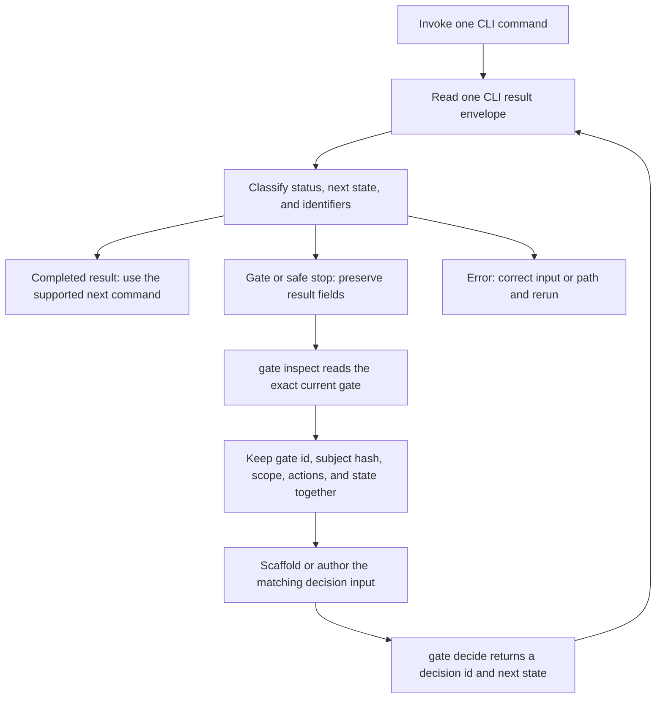
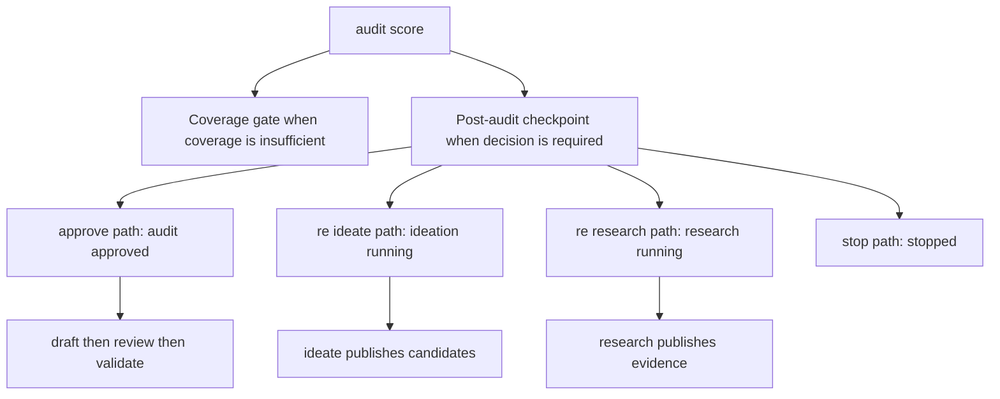

The local authority is `python3 -m patent_factory`. It validates requests, controls run state, creates artifacts and decisions, and owns deletion. Slash commands can guide an operator and invoke it, but they do not replace a CLI transition or authorize a gate. This page is the operational reference for the filesystem boundary and command surface; see [System Overview](/openwiki/architecture/system-overview.md) for architecture and [Privacy and Authority Boundaries](/openwiki/concepts/privacy-and-authority-boundaries.md) for transfer policy.

> **Operating rule:** parse the JSON result before acting on the process exit code. A nonzero exit can be an intentional gate or recoverable safe stop, while a zero exit means only that the invoked operation completed.

## Start with the two private roots

Initialize once from the repository working directory:

```bash
python3 -m patent_factory init
```

`init` creates the default owner-only `documents/` and `workspace/` roots, plus their `requests/` directories. Alternative roots are allowed only as repository-relative values:

```bash
python3 -m patent_factory init --documents documents --workspace workspace
```

The roots have separate roles.

```text
documents/                         private source material and local imports
  background.md                    profile source document
  requests/                        fixture manifests and manual import inputs
workspace/                         private generated state and operator request inputs
  profile.sqlite3                  authoritative profile state
  profile.json                     deterministic profile export
  requests/                        versioned inputs authored from drafts
    ideation/RUN_ID/               non-authoritative ideation workbench
  runs/RUN/
    factory.sqlite3                authoritative state for this one run
    bootstrap-exports/             profile-context export
    research-exports/              research manifests
    decision-exports/              durable gate-resolution exports
    ...                            report, review, validation, and share artifacts
```

`documents/README.md` and `workspace/README.md` are the tracked orientation files; other private content below those roots is git-ignored. `profile.sqlite3` is authoritative and `profile.json` is an export—do not hand-edit either. Likewise, `factory.sqlite3` is not an operator-managed cache.

### Path and privacy invariants

All CLI path arguments are relative to the repository process working directory. The path policy rejects absolute paths, `..`, a symbolic link at the root, any intermediate path component, or the target, and an input must be a regular file (or an explicitly requested directory) beneath its designated root. A run directory must be below, rather than equal to, the workspace root. The policy enforces private directories at `0700`; commands that create private request/template files set them to `0600`.

Use the root appropriate to the data:

| Data or argument | Designated root | Examples |
| --- | --- | --- |
| Profile source, scripted interview response, fixture XML, manual import, audit fixture manifest | `documents/` | `documents/background.md`, `documents/requests/audit-fixture-manifest-v1.json` |
| Profile database/export, run directory, stage request JSON, scaffold output | `workspace/` | `workspace/profile.sqlite3`, `workspace/runs/RUN`, `workspace/requests/...` |
| Per-run state and immutable exports | selected run under `workspace/` | `workspace/runs/RUN/factory.sqlite3` |

Profile text inputs are UTF-8 `.md`, `.txt`, or supported JSON and have a 2,000,000-byte document limit. Many other file-taking verbs also take `--byte-budget`; honor that command-specific limit rather than assuming a large input will be accepted. A local path does **not** authorize putting its content into a hosted model context. Keep `KIPRIS_PLUS_API_KEY` and `SERPAPI_API_KEY` in the environment, never in documents or request JSON.

## Consume the JSON envelope as a protocol

Except for plain-text `--help` and `--version`, the CLI emits one compact, sorted JSON object on stdout. This includes argument errors: invalid or missing arguments produce an enveloped `status: "error"` result rather than argparse prose.

Every handled result is augmented with:

- `schema_version: "cli-result-v1"` and `envelope_version: "cli-envelope-v1"`;
- `command`, `started_at`, `ended_at`, `prior_state`, `next_state`, `artifact_ids`, and `event_ids`;
- `run_id` when that command received one;
- `failure_code`, which is `null` for a handled non-error result; and
- `adapter_summary` when the underlying payload contains `adapter_status`.

The stage-specific payload is retained alongside those common fields. For a caught error, read `status`, `error`, and `failure_code`; expected categories include `invalid_arguments`, `invalid_json`, `invalid_unicode`, `io_error`, `invalid_input`, `runtime_error`, and component-specific codes. Error rendering replaces any currently configured known-credential value with `[REDACTED]`; that is not a reason to put a secret in an input.



This is the result-driven control loop. It distinguishes a completed command, an intentional hold that needs a bounded decision, and an enveloped error that needs correction.

### Exit codes: classify, do not flatten

| Exit | Typical `status` or condition | Operator response |
| ---: | --- | --- |
| `0` | Command completed, including a legitimate replay or a `stopped` decision. | Still read `status` and `next_state`; do not infer pipeline completion. |
| `2` | Enveloped argument, path, schema, state, I/O, or validation error. | Correct the named condition; do not repair SQLite or exports. |
| `3` | `conflict_resolution_required` after profile ingestion. | Inspect and resolve the exact profile conflict batch. |
| `4` | Research did not reach `complete`, commonly `incomplete`. | Preserve `incomplete_reason` and choose a supported follow-up. |
| `5` | Credential gate from KIPRIS/audit, or `insufficient_evidence` from shortlist. | Branch on `command` and `status`; do not treat the shared code as one outcome. |
| `6` | `domain_pivot_required` from ideation. | Resolve the domain-pivot gate before proceeding. |
| `7` | `coverage_insufficient` from audit scoring. | Resolve the coverage gate with its allowed action and bounded plan where required. |
| `8` | `decision_required` from `audit score`. | Run the post-audit checkpoint flow—even a clean score normally stops here. |
| `9` | `sensitive_disclosure_required` from `share`. | Inspect and resolve the exact disclosure scope before resuming. |
| `10` | `revision_required` from independent review. | Return to a corrected draft; do not validate that revision. |
| `11` | `delete-run` reports `partial_failure`. | Retain the failures list and remediate the reported cleanup issue. |
| `12` | Confirmed SerpApi `quota_exhausted`. | Use the emitted manual-import template; do not fabricate a search result. |
| `13` | SerpApi `credential_required`. | Resolve the exact credential gate and resume with its decision identifier. |

## Choose a command family by operator task

The following is a compact surface map, arranged by work to be done rather than parser order. All examples assume relative paths and replace `RUN`, `RUN_ID`, `GATE_ID`, and request filenames with actual values.

| Task | Commands | What the core owns |
| --- | --- | --- |
| Initialize private storage | `init` | Creates/checks private roots and requests folders. |
| Build an inventor profile | `profile folder`, `profile document`, `profile interview`, `profile conflict-inspect`, `profile conflict-decide` | Ingests facts, exports profile state, and blocks conflicting batches. |
| Bind a run and inspect it | `run start`, `run status`, `run show` | Binds an authoritative profile into one run; exposes current state/artifacts through stdout. |
| Collect bounded evidence | `research fixture`, `research manual`, `research kipris`, `research serpapi`, `research normalize-web` | Validates the adapter/input boundary, budgets, idempotency, evidence, and live credential gates. |
| Prepare a request safely | `scaffold candidate`, `shortlist`, `audit-query`, `report`, `ideation-workbench`, `feature-map`, `gate-decision` | Reads current authoritative state to prefill clerical bindings and leaves judgment to the operator. |
| Publish candidates/finalists | `ideate`, `shortlist` | Validates profile/evidence/hash bindings and records candidates or an explicit insufficiency outcome. |
| Retrieve and score similarity evidence | `audit retrieve`, `audit score` | Builds finalist-specific corpus state, validates sealed feature maps, and raises audit gates. |
| Inspect or resolve a gate | `gate inspect`, `gate decide` | Reveals exact current scope/actions and records the only valid gate transition. |
| Draft, review, validate, and optionally share | `draft`, `review`, `validate`, `share` | Publishes the private report, independent review and deterministic validation; separately guards external sharing. |
| Remove a run | `delete-run` | Performs contained, no-link-following deletion and reports every removal/failure. |

### Profile first, then bootstrap one run

Choose one input route:

```bash
python3 -m patent_factory profile folder documents
python3 -m patent_factory profile document documents/background.md
python3 -m patent_factory profile interview --responses documents/interview.json
```

Each successful profile operation updates `workspace/profile.sqlite3` and regenerates `workspace/profile.json`. If one incoming batch conflicts, the core records the conflict batch but does not silently apply the canonical/compatible facts from it. Follow the `profile conflict-inspect` and `profile conflict-decide` route instead of editing the export.

Start a run only from the current, conflict-free profile:

```bash
python3 -m patent_factory run start \
  --run workspace/runs/RUN --run-id RUN_ID \
  --profile workspace/profile.json \
  --profile-database workspace/profile.sqlite3
```

`run start` verifies that the supplied JSON export canonically matches the authoritative profile database, requires `profile_ready`, uses a run database distinct from the profile database, publishes a `profile_context`, and advances the new run to `research_ready`. Repeating an identical start replays the prior bootstrap rather than creating another one.

### Use `run status` and `run show`, not direct database inspection

Do not open `factory.sqlite3` to discover a hash or reconstruct current state. The supported read interface is:

```bash
python3 -m patent_factory run status \
  --run workspace/runs/RUN --run-id RUN_ID

python3 -m patent_factory run show \
  --run workspace/runs/RUN --run-id RUN_ID --kind corpus_set
```

`run status` returns the current run state, state version, and every current non-stale artifact's kind, revision ID, schema version, creation time, and `content_hash`. Use those hashes when an authored contract calls for a current artifact hash. `run show --kind KIND` returns the current artifact body and the same hash, which is essential for retained corpus records and review/audit inputs. If the requested kind is absent, the error names available current kinds; do not guess an ID or hash.

## Run research through a bounded source mode

Research requires a bootstrapped run and produces state rather than a loose file collection:

```bash
python3 -m patent_factory research fixture documents/kipris.xml \
  --run workspace/runs/RUN --run-id RUN_ID --query "sensor"

python3 -m patent_factory research manual documents/manual-results.json \
  --run workspace/runs/RUN --run-id RUN_ID --query "sensor" \
  --allow-host patents.google.com
```

- `fixture` consumes a local KIPRIS fixture under `documents/` for deterministic/offline work.
- `manual` imports supplied records after sanitizing them against one or more explicit allowed hosts; it does not fetch the web.
- `normalize-web` converts a local `web-rows-v1` object to a manual-import JSON under `documents/`, again using an explicit host allowlist. It is an offline normalizer, not a crawler.
- `kipris` and `serpapi` are opt-in live modes. They read their credentials from `KIPRIS_PLUS_API_KEY` or `SERPAPI_API_KEY`, validate bounds and state before work, and can suspend behind a credential gate. SerpApi also has an explicit quota stop and manual-import fallback.

A request that receives a credential gate is not permission to retry creatively. Preserve the result, inspect its gate, decide the current scope, and resume only as the resulting `decision_id` authorizes. Research is normally one operation for a completed run; additional research is available only through supported gate-mediated branches such as audit coverage expansion or checkpoint re-research.

## Generate request inputs from state, then supply judgment

`workspace/requests/` holds versioned JSON inputs. These files are operator-authored *requests*, not current workflow state. The core validates their exact schema, hashes, identifiers, and upstream dependencies when the stage command runs.

> **Never invent a binding.** `ca_...`, `fi_...`, `ev_...`, `cl_...`, `gate_id`, `decision_id`, `subject_revision_hash`, `report_hash`, and every `*_hash` must come from authoritative command output, `run status`/`run show`, `gate inspect`, or a scaffold that read that state. A copied value is still rejected if the subject has become stale.

The scaffold verbs remove transcription work; they do not create an approval, a review, evidence, or a valid submission by themselves. Every draft writes `TODO(agent):` where a human/agent judgment is needed. `todo_count` in the scaffold response helps locate unfinished text, but only the consuming core command determines whether the completed request is acceptable.

| Request or work area | Generate it with | Core-derived content | You must supply |
| --- | --- | --- | --- |
| Candidate request | `scaffold candidate --run ... --run-id ... --profile-database ... --out ...` | Current profile problem/capability claim references and research evidence/span references. | Technical proposal, claim wording/labels, synthesis explanation, validation, and open questions. |
| Shortlist request | `scaffold shortlist --run ... --run-id ... --out ...` | Candidate IDs, evidence references, and configured rubric versions. | Scores, rationales, coverage assessments, and selection/exclusion rationale. |
| Audit-query request | `scaffold audit-query --run ... --run-id ... --out ...` | Current `finalist_set_hash` and finalist IDs. | Bounded Korean and English query terms. |
| Report request | `scaffold report --language en --out ...` | Renderable profile field names, excluding sensitive/profile-forbidden fields. | Drafter identity, date, handoff questions, investigations, and disclosures. |
| Ideation workbench | `scaffold ideation-workbench --out ...` | A minimized hash-bound profile/research brief and private workbench layout. | Raw ideas, links, clustering, promoted candidate content, and notes. |
| Feature-map request | `scaffold feature-map --run ... --run-id ... --out ...` | Finalist/corpus hashes, candidate span hashes, feature weights, and reference-span choices menu. | Feature description, reviewed reference decisions/rationale/spans, and a real review attestation. |
| Post-audit decision | `scaffold gate-decision --run ... --run-id ... --gate-id ... --out ...` | Pending checkpoint's `gate_id`, subject hash, scope, finalist bindings, and fixed decision shape. | Action, actor, reason, per-finalist feedback, and a bounded plan only for `re_research`. |

### Candidate, shortlist, audit-query, and report drafts

Candidate scaffolding requires current research evidence plus a profile with both a problem-like and a capability-like fact; `--count` is limited to 1 through 12 and defaults to three. It creates evidence references rather than asking an operator to fabricate evidence IDs or span hashes.

Shortlist scaffolding requires a current candidate set. It proposes up to the first three candidates, includes all configured scoring axes, and emits a rejectable `TODO(agent)` score placeholder rather than a misleading numeric zero. If fewer than the configured minimum are available, it prepares an explicit insufficiency structure rather than inventing a third finalist.

Audit-query scaffolding requires a current finalist set and binds its exact `finalist_set_hash`. Report scaffolding reads the authoritative profile only; it defaults to English but permits `en` or `ko`. These scaffolds produce `candidate-input-v1`, `shortlist-input-v1`, `audit-query-input-v1`, and `report-input-v2` shapes respectively. Submit them to `ideate`, `shortlist`, `audit retrieve`, and `draft` only after filling the actual judgment fields.

### Ideation workbench is deliberately non-authoritative

The workbench begins with a private `brief-v1.json` below `workspace/requests/ideation/RUN_ID/`; initialization creates `sessions/`, `promoted/`, history handling, and `notes.md`. The brief binds profile/evidence/configuration by hash and marks semantic content unavailable for egress. It does not publish candidates or advance the run.

Validate the workbench without writing state before submitting its promoted candidate input:

```bash
python3 -m patent_factory scaffold ideation-workbench \
  --run workspace/runs/RUN --run-id RUN_ID \
  --profile-database workspace/profile.sqlite3 \
  --validate workspace/requests/ideation/RUN_ID --stage promote
```

`--out` and `--validate` are mutually exclusive, and `--stage` is valid only with `--validate`. The validation path opens both databases read-only and does not create artifacts, gates, exports, or state transitions. Only `ideate` accepting `promoted/candidate-input-v1.json` publishes candidates and assigns core-owned `ca_*` IDs.

### Feature maps must be filled, then sealed

`audit score` expects `feature-map-set-input-v1`; it is not the same contract as the persisted `schemas/feature-map.schema.json` artifact. Generate the input after audit retrieval, fill the reviewer-owned fields, then seal it as the final clerical operation:

```bash
python3 -m patent_factory scaffold feature-map \
  --run workspace/runs/RUN --run-id RUN_ID \
  --out workspace/requests/feature-map-set-input-v1.json

python3 -m patent_factory scaffold feature-map \
  --seal workspace/requests/feature-map-set-input-v1.json \
  --out workspace/requests/feature-map-set-input-v1.json
```

The generator derives the current finalist/corpus hashes, candidate span hashes, configuration-exact weights, and the menu of available reference spans. It intentionally leaves reference-span selection, disclosure status/rationale, feature descriptions, and the human review attestation unfilled. It also cannot prefill `map_id`, because that ID hashes the *filled* canonical map.

`--seal` refuses any remaining `TODO(agent)` marker in a map, removes the scaffold-only `available_reference_span_hashes` menus, and recomputes each `map_id`. It does not change a reviewer judgment and it does not make an invalid map valid—`audit score` remains the authoritative validator.

## Treat gates as exact, expiring capabilities

A gate is a state-machine boundary, not an error message to work around. On a gate/safe-stop result, retain the whole result JSON. Then inspect the exact gate:

```bash
python3 -m patent_factory gate inspect \
  --run workspace/runs/RUN --run-id RUN_ID --gate-id GATE_ID
```

The inspection response is the source for the gate's `actions`, `approval_scope`, `approval_scope_hash`, `subject_revision_hash`, `return_state`, `suspended_operation`, kind, and pending/superseded status. Keep `gate_id`, `subject_revision_hash`, `approval_scope`, allowed `actions`, and `next_state`/return state together. Do not select an action from memory and do not reuse a decision from a prior artifact revision.

A decision input must echo the inspected `gate_id`, subject hash, and scope exactly. The core verifies that the subject remains current, verifies the allowed action for the gate kind, maps that action to the target state itself, persists a resolution artifact, and returns its core-issued `decision_id`. Upstream replacement invalidates dependent artifacts and stales related decisions, so a previous hash or `decision_id` is not a general permission.

For ordinary gate kinds, `gate decide` accepts the exact `gate-decision-input-v1` shape. A `post_audit_checkpoint` requires the exact `gate-decision-input-v2` shape and is the only kind supported by `scaffold gate-decision`; the scaffold also refuses a gate that is not pending. The core rejects a leftover `TODO(agent)` marker in checkpoint decision fields.



This audit decision flow is core-owned. `audit score` commonly returns exit `8` and a post-audit checkpoint even when no finalist has an excessive-similarity result; it is never an instruction to draft directly. Checkpoint `approve` may be rejected while another finalist remains coverage-insufficient. `re_research` requires a real bounded plan; other checkpoint actions require `plan: {}`. For a breaching approve, the required `retain_with_warning` entries are constrained by the current affected finalist set and the core derives remaining binding fields.

## Finish the report lifecycle and share only through the guard

After the authorized audit path, use the normal private lifecycle:

```bash
python3 -m patent_factory draft --run workspace/runs/RUN --run-id RUN_ID \
  --input workspace/requests/report-input-v2.json
python3 -m patent_factory review --run workspace/runs/RUN --run-id RUN_ID \
  --input workspace/requests/review-input-v1.json
python3 -m patent_factory validate --run workspace/runs/RUN --run-id RUN_ID
```

The review input binds a current `report_hash` and represents an independent review. A `revision_required` result is a hard return to drafting; validation resolves a run ID only when it is unambiguous and is not a substitute for review.

Sharing is a separate operation, not copying a report file:

```bash
python3 -m patent_factory share --run workspace/runs/RUN --run-id RUN_ID \
  --input workspace/requests/external-report-share-v1.json
```

A share input binds the validated report hash, recipient, purpose, destination, and sensitive fields. If the requested scope needs approval, `share` returns `sensitive_disclosure_required`; inspect and decide that exact gate, then resume with the issued `--decision-id`. Local CLI execution and a completed report do not grant an external-share approval.

## Delete runs only with `delete-run`

Do **not** delete a run directory, its database, or its exports manually. Use the supported cleanup command, which deliberately takes the run path but no `--run-id`:

```bash
python3 -m patent_factory delete-run \
  --run workspace/runs/RUN --workspace-root workspace
```

The command first requires an existing contained run directory, rejects a symlink root, and refuses the workspace root itself. Its recursive remover uses `lstat`: a symlink encountered inside the run is unlinked rather than traversed, and sibling/outside paths are not touched. The response lists `removed` paths and `failures`; it returns `status: "deleted"` only when complete, or `partial_failure` and exit `11` when remediation is needed. Preserve that report rather than retrying arbitrary filesystem deletion.

## Operator checklist and focused verification

Before each mutation:

1. Ensure the input path is relative, non-symlinked, and under its designated private root.
2. Use the latest `run status`/`run show` output to acquire current artifacts; use `gate inspect` for a gate's exact scope.
3. Generate scaffolds for derivable IDs, hashes, weights, and spans; fill only the human judgment fields.
4. Seal feature maps after filling them, and submit a request only to its matching verb.
5. Preserve the complete JSON output. Branch on `status`, `next_state`, `gate_id`, hashes, actions, and issued `decision_id`, not shell code alone.
6. Use `delete-run` for cleanup and preserve a partial-failure result.

The focused integration coverage reflects these operational guarantees: `tests/integration/test_g008_cli_core.py` exercises envelopes, run bootstrap/replay, private permissions, invalid-argument behavior, redaction, and no-follow deletion; `tests/integration/test_g009_scaffolds.py` round-trips the principal drafts and guards TODO score placeholders; `tests/integration/test_scaffold_feature_map.py` checks derived spans/weights and fill-seal-score behavior; and `tests/integration/test_run_inspection.py` verifies that status/show expose current hashes and artifact bodies without direct SQLite access. For stage-by-stage use, continue with [Quickstart](/openwiki/quickstart.md), [Ideation and Finalist Selection](/openwiki/workflows/ideation-and-finalist-selection.md), [Profile and Run Bootstrap](/openwiki/workflows/profile-and-run-bootstrap.md), and [Similarity Audit and Human Checkpoint](/openwiki/workflows/similarity-audit-and-human-checkpoint.md).
