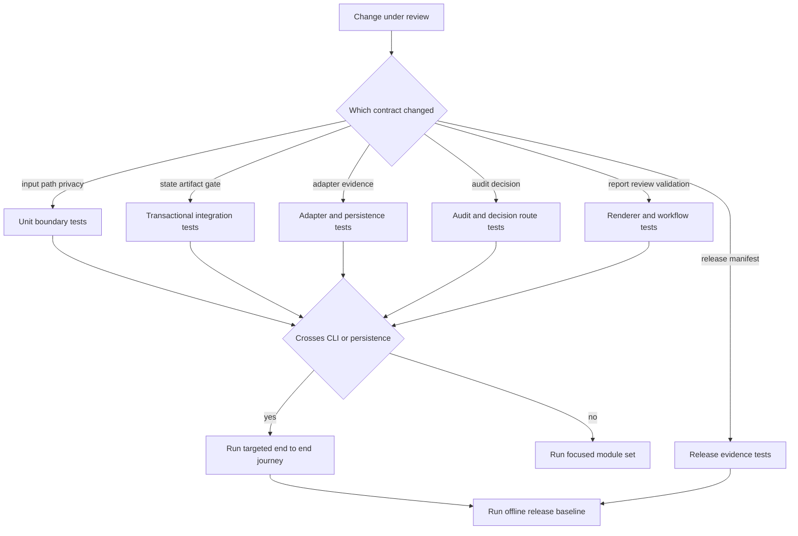

# Verification Strategy and High-Value Test Boundaries

This repository should be verified by the behavioral contract at risk, not by a broad habit of “run everything.” The CLI is a thin interface to an authoritative Python core: state changes, gate decisions, invalidation, idempotency, and exports belong to that core. Consequently, a useful test proves a safety or lifecycle invariant at the boundary that owns it; a passing parser or renderer test alone does not establish that a changed workflow can safely publish, resume, or release.

Source and tests are authoritative over this page. Treat a test failure as evidence about the current contract, not as a reason to weaken an assertion or update a golden without understanding the change. The command output contract is also a privacy boundary: preserve the complete failure output in the authorized local/CI record, but do not put private documents, workspace data, credential values, or canaries in tickets, chat, or diagnostics.

## Verification model

Tests form a narrowing ladder. Start at the smallest layer that owns the invariant; escalate when the change crosses an ownership boundary, changes a persisted representation, or changes an observable CLI/release result.



This diagram shows the escalation path from an owning contract to focused, end-to-end, and release-level checks.

### What each layer is allowed to prove

| Layer | Best use | It proves | It does not replace |
| --- | --- | --- | --- |
| Unit | Pure validation, normalization, boundary rejection, and deterministic identity rules | A function or adapter boundary rejects unsafe data and preserves its local contract | SQLite transaction ordering, current-pointer invalidation, real CLI envelopes, or export recovery |
| Integration | The authoritative state store and one workflow’s publication path | Atomic state/artifact behavior, gate routing, persistence, schema binding, stale-input refusal, and replay/concurrency semantics | A whole CLI journey or a committed rendered golden |
| End-to-end | A user-visible sequence driven through the real CLI with local fixtures | The stages compose, command results are usable, required gates appear, and final externally visible output is stable | All fault windows and all race schedules |
| Release evidence | A release candidate and a completed authoritative run | Required scenario mapping, core checks, private-path/canary scanning, run validation, calibration status, and a reproducible manifest | A substitute for the ordinary test suite or permission for live network egress |

The distinction matters because a stateful system can be locally correct while globally unsafe. For example, a serializer can render a report successfully while its upstream decision is stale, or a research adapter can parse a response correctly while a credential request is not authorized for a second pass.

## Contract map and focused modules

The following groups are the primary selection surface. The named modules are representative focused checks, not a requirement to run every module for every edit.

| Behavioral contract | Representative focused tests | Select when changing | High-value assertions |
| --- | --- | --- | --- |
| **Input, path, and privacy boundaries** | `tests/unit/test_privacy.py`, `tests/unit/test_g003_adapters.py`, `tests/integration/test_cli_profile_paths.py`, `tests/integration/test_g003_research_persistence.py` | Path resolution, private-root modes, input schemas, manual imports, credential diagnostics, adapter response handling, or deletion/sharing containment | Relative contained paths only; symlink and traversal rejection; owner-only private roots; unknown/private fields rejected before fingerprinting or persistence; secret/canary values absent from errors and diagnostics |
| **Transactional state and artifact invalidation** | `tests/integration/test_g002_transactional_state_kernel.py`, `tests/integration/test_g002_publish_register_integration.py`, `tests/integration/test_g002_invalidation_dag.py`, `tests/integration/test_g002_snapshot_and_integrity.py` | `StateStore`, migrations, transaction boundaries, artifact dependencies, exports, idempotency, gate consumption, or concurrent writers | Only legal state edges; gate states cannot be bypassed; revision identity includes content, dependencies, and schema; descendant revisions and stale approvals are invalidated atomically; replay cannot revive a stale artifact; recovery removes unregistered exports and detects registered-export tampering |
| **Evidence persistence and adapters** | `tests/unit/test_g003_adapters.py`, `tests/integration/test_g003_research_persistence.py`, `tests/integration/test_g003_research_cli.py`, `tests/integration/test_g009_normalize_web.py`, `tests/integration/test_research_manifest_stage_scope.py` | KIPRIS/manual/web normalization, query plans, pagination, adapter failures, research manifests, provenance fields, or credentialed retrieval | Allowlisted HTTPS target and redirect policy; bounded response/result handling; normalized metadata only; evidence identity by locator plus content; observations and limitations persist even for failures; retry is idempotent; a research bundle excludes audit-tagged retrieval rows |
| **Decision and gate routes** | `tests/integration/test_g005_audit.py`, `tests/integration/test_g006_decisions.py`, `tests/integration/test_g010_checkpoint.py`, `tests/integration/test_research_reentry_gate.py`, `tests/integration/test_research_reentry_guard.py` | Audit corpus/score behavior, feature-map schema, approval scope, gate input versions, coverage/excessive/checkpoint routing, re-ideation, re-research, or credential re-entry | Frozen feature maps bind exact current finalist and corpus inputs; audit publication raises an atomic gate; gate input must match subject and scope; policy owns the target state; checkpoint feedback covers every current finalist; a bounded re-research plan is hash-bound; a live second pass requires a fresh credential approval and cannot egress from stale or unbound re-entry state |
| **Report, review, validation, and sharing** | `tests/integration/test_g007_report_review_validation.py`, `tests/integration/test_g009_english_report.py`, `tests/integration/test_us016_citation_binding.py` | Report policy/rendering, language, citation placement, reviewer identity, validation rules, redaction, or external sharing | Report content is reconstructed from current bindings; reviewer identity and pass differ from the drafter; unqualified legal conclusions fail; validation checks bindings, citations, decision coverage, structure, review, and canonical reconstruction; `complete` requires current report/review/validation artifacts; sensitive share approval is exact and one-use |
| **Release evidence** | `tests/e2e/test_release_evidence.py`, `scripts/release_verify.py`, `scripts/calibration_check.py` | Release verifier, required-test policy, calibration trust, manifest publishing, privacy scanning, or release status rules | Mandatory named tests must all run and pass without skips; command streams and tracked/run files are scanned without echoing canaries; a skipped suite or untrusted/absent calibration blocks release; failed core validation prevents authoritative-run inspection; manifest publication is contained, owner-only, immutable, and durable |

### Input and privacy tests are ingress tests

Do not defer input/privacy coverage until an end-to-end run. The narrow checks are designed to prove that unsafe content never reaches a durable or externally visible surface:

- `test_privacy.py` exercises redacted secret status and diagnostics, current exact approval for a hosted callback, canary detection before callback execution, and symlink-safe deletion.
- `test_g003_adapters.py` exercises the network boundary with a local HTTP server and fixture transports: the KIPRIS default transport refuses redirects, target/response failures normalize to typed failures, and manual imports require a closed metadata schema, HTTPS allowlist, provenance, and budgets.
- `test_g003_research_persistence.py` is the persistence complement: a private unknown manual field must fail before a query, adapter event, database bytes, or export is written. It also makes adapter failure observable as a failure event, observation, and coverage limitation rather than fabricated evidence.

Use fake transports and explicit canary values in tests, never a real document, profile, credential, or workspace export. Assert absence of the canary in the error and persisted bytes where the test is exercising a write boundary.

## State, artifact, and failure semantics

The highest-value integration target is the state kernel because it combines SQLite state, immutable artifact history, current pointers, dependency invalidation, gate records, filesystem exports, and replay. A change in this area must be tested for both a successful path and an interrupted/competing path.

### Minimum kernel regression set

Start with `tests/integration/test_g002_transactional_state_kernel.py` when changing `state.py`, migrations, revision identity, gate mechanics, or idempotency. Its fault-injection and contention cases protect the non-obvious properties:

1. migrations retain old data, roll back on an injected fault, and reject unsupported future versions;
2. legal transition edges produce ordered evidence, while normal APIs cannot enter or leave a mandatory gate state;
3. replacing an upstream revision stales every dependency descendant, drops their current pointers, and stales decisions bound to affected hashes;
4. each transaction boundary rolls back revisions, dependencies, events, state, and idempotency records together;
5. a locked writer becomes a bounded, retryable, redacted `run_busy` error rather than leaking a database path; and
6. exact subject/scope/operation matching makes authorization consumption single-purpose and single-use.

A focused pass for that surface is:

```bash
python3 -m unittest tests.integration.test_g002_transactional_state_kernel
```

Add `tests/integration/test_g002_publish_register_integration.py` whenever publication/recovery changes, and add `tests/integration/test_g002_invalidation_dag.py` whenever a new artifact kind or dependency edge is introduced. A new persistent artifact must declare all of its upstream revisions and receive a fault/replay test; otherwise it can remain apparently current after one of its inputs changes.

### When a fault or concurrency test is necessary

A regular success test is insufficient if the change adds or moves a write between any of these logical boundaries: immutable export, artifact revision, dependency edge, current pointer, transition event, run state, idempotency record, gate decision, or approval claim. Use an injected fault at the new boundary and assert both that the database has no partial authoritative result and that startup recovery handles an orphan export safely.

A concurrency test is necessary when two workers can use the same idempotency key, decide the same gate, publish the same output, or consume the same authorization. Test both cases:

- **identical attempts** converge on one write and one replay; and
- **competing different attempts** have one winner and one blocked outcome, with no duplicate decision/artifact.

`test_g006_decisions.py` covers both forms for gate resolution, while `test_g007_report_review_validation.py` covers competing report publication. These tests are especially important after changing a transaction’s read-before-write order, a unique key, or idempotency/replay lookup.

## Evidence and adapter verification

Research has two different contracts that should be tested separately.

1. **Adapter contract:** it accepts only an approved request shape and turns a bounded response into normalized records or a typed failure. The KIPRIS adapter prevents redirect following, validates the fixed HTTPS host and final URL, keeps `ServiceKey` process-only, rejects unsafe XML and malformed pagination, and normalizes classifications and dates. The manual adapter sanitizes public metadata before the request fingerprint is calculated or storage is touched.
2. **Research-store contract:** it records what was attempted even when no usable evidence exists. It deduplicates evidence by stable source locator and content hash while retaining query-observation edges, records empty successes, and records failures as observations and coverage limitations without creating evidence records.

Use this focused progression for adapter or research-store changes:

```bash
python3 -m unittest tests.unit.test_g003_adapters tests.integration.test_g003_research_persistence
python3 -m unittest tests.integration.test_g003_research_cli tests.integration.test_g009_normalize_web
```

Add `tests/integration/test_research_pagination.py` or `tests/integration/test_audit_pagination.py` for changes to cursors, page sizes, result caps, or query keys. Add `tests/integration/test_research_manifest_stage_scope.py` when changing manifests or reuse of research tables: audit retrieval uses the same persistence tables, but re-published `research_bundle` data must exclude queries whose `term_kind` begins with `audit_`.

### Provenance contract checks

`tests/unit/test_provenance_contracts.py` is the focused guard for epistemic labels and source representation. Source facts and source inferences must carry content and span bindings; inference paths require rationales; interpretations cannot masquerade as quotes; and evidence identity intentionally does not depend on retrieval time. Run it with research/schema changes that affect evidence IDs, claim serialization, quoted spans, or labels:

```bash
python3 -m unittest tests.unit.test_provenance_contracts
```

## Audit and human decision verification

Audit retrieval and scoring should be tested at the gate boundary, not merely by snapshotting a score. `run_audit_scoring()` checks that one canonical frozen feature map exists for every current finalist, that its `map_id` binds the completed map, and that candidate/reference span hashes belong to the current finalist and retained corpus. It validates the derived audit batch before atomically publishing the batch and its gate.

The route has an intentional asymmetry:

- any `decision_required` result causes the `post_audit_checkpoint`, even when another finalist is `coverage_insufficient`;
- coverage is raised only when no finalist requires a decision; and
- a clean audit also raises `post_audit_checkpoint`, so `audit score` returns `decision_required` with exit code 8 until a user-authored checkpoint action is resolved.

`tests/integration/test_g005_audit.py` is the primary retrieval/feature-map binding test. `tests/integration/test_g006_decisions.py` proves old excessive-similarity and coverage routes, exact binding/staleness, bounded plans, transactional rollback, and concurrent decision behavior. `tests/integration/test_g010_checkpoint.py` is required for changes to the unified checkpoint: it covers the v2 decision schema, exact all-finalist feedback, clean/breaching approval, legal-language screening of durable decision prose, `re_ideate`, `re_research`, `stop`, report decision coverage, and CLI exit-8 behavior.

Run the narrow route set when editing score, gate scope, decision validation, or re-entry code:

```bash
python3 -m unittest tests.integration.test_g005_audit tests.integration.test_g006_decisions
python3 -m unittest tests.integration.test_g010_checkpoint
```

A `re_research` change requires the re-entry guard tests even if its immediate unit behavior passes. The re-entry anchor is derived from persisted decision/event history; a credentialed second pass is force-gated with the bounded plan, its hash, and literal proposed terms in the approval scope. Test stale anchors, missing/mismatched plans, spent coordinates, offline recovery, and no-egress refusal with `tests/integration/test_research_reentry_gate.py` and `tests/integration/test_research_reentry_guard.py`.

## Report, review, validation, and sharing

The report path is an artifact contract, not a template-only path. Changes to report construction, markdown, policy, citation rendering, or decision display must be checked through review and deterministic validation.

`tests/integration/test_g007_report_review_validation.py` provides the core fixture and workflow:

- it drives `draft` → `review` → `validate` through the real CLI and through core entrypoints;
- it verifies deterministic report sections, schemas, immutable exports, recovery/tamper detection, and race outcomes;
- it rejects same-identity reviewer/drafter pairs and unqualified patentability, validity, or non-infringement language even if caller-provided checks say pass;
- it verifies semantic reconstruction, not just JSON shape, so altered narrative, matrix order, appendix, report/review/validation hashes, or audit results cannot complete a run; and
- it exercises exact sensitive disclosure approval, scope mismatch refusal, one-use share replay, redaction invalidation, and symlink-safe destinations.

`tests/integration/test_g009_english_report.py` extends this through the English renderer and policy; `tests/integration/test_us016_citation_binding.py` protects per-field citation placement and rejects citations on hedged, unsupported text. Select them when changing lexicon, language, report policy, citation logic, source labels, report input schema, or sharing/redaction.

```bash
python3 -m unittest tests.integration.test_g007_report_review_validation
python3 -m unittest tests.integration.test_g009_english_report tests.integration.test_us016_citation_binding
```

Validation recomputes its expected manifest from the current report and approved review. The completion transition independently rechecks current report/review/validation artifacts, their hashes and dependency edges, report bindings, and the deterministic validation result. Therefore, a new validation check normally needs three tests: the checker’s own success/failure cases, a validation-manifest case, and a forged/changed-current-artifact case that proves `complete` still fails closed.

## End-to-end tests: when to pay for the whole journey

The end-to-end suite uses local fixtures, temporary directories under the repository private roots, and the real CLI. It is the right level when a change modifies the handoff between several stages or a user-visible output, not as a default substitute for narrow contract tests.

### Golden full journey

`tests/e2e/test_full_journey.py` is the golden Justin journey. It goes from `init` and profile creation through offline normalized/manual research, candidate and shortlist scaffolds, fixture audit retrieval, checkpoint approval, English draft, independent review, and `validate`. The final exported markdown is byte-compared to `examples/justin/expected-report-en.md`.

Run it when changing any of the following together: CLI command orchestration, the audit-to-checkpoint handoff, report renderer/output policy, scaffold bindings, state transitions across stages, or the committed golden fixture. Do **not** use `JUSTIN_GOLDEN_REGENERATE=1` as a way to make a failure disappear. Set it only after intentionally reviewing a renderer/output change and updating the committed expected report as part of that deliberate contract change.

```bash
python3 -m unittest tests.e2e.test_full_journey
```

### Re-entry journey

`tests/e2e/test_research_reentry.py` is necessary when a coverage expansion or downstream invalidation may allow stale work to leak forward. It deliberately creates insufficient coverage, resolves `coverage` with an `expand` plan, imports a second research batch, verifies that downstream revisions and the old decision are stale, verifies audit-tagged retrieval did not contaminate the research bundle, and proves the work must be re-ideated, re-shortlisted, retrieved, rescored, and checkpoint-approved before advancing again.

```bash
python3 -m unittest tests.e2e.test_research_reentry
```

Run this journey for changes in invalidation, coverage routing, stage-scoped research manifests, gate-resolution payloads, or the transition back from research. A unit test of one invalidated pointer is not enough to prove that the workflow cannot skip the rework sequence.

## Release evidence and the required offline baseline

Before release, the repository contract requires at least the following offline checks from `AGENTS.md`:

```bash
python3 -m unittest discover -s tests -p 'test_*.py'
python3 -m compileall -q src tests
python3 -m patent_factory --help
```

Run the focused modules first during development, then this baseline before release or when a change spans more than one behavioral group. Keep the complete command failure output in the authorized validation log. If a command prints private content, preserve that record only in the approved private incident/CI location and share a redacted summary externally; never “sanitize” by discarding the failure evidence.

`tests/e2e/test_release_evidence.py` and `scripts/release_verify.py` add release-specific assertions beyond the three baseline commands:

- the verifier maps seven named scenarios to importable integration test methods, then runs required IDs such that a skip, load failure, expected failure, unexpected success, or count mismatch fails the required-test gate;
- it validates a completed run using the supported path-only validator before reading authoritative artifact data;
- it scans captured command streams, run files, and all tracked files for canaries while storing hashes/counts rather than secret-bearing output;
- it blocks release on failed core checks, skipped/failed tests, or calibration that is absent, untrusted, or otherwise not eligible; and
- it writes a contained owner-only manifest with no-clobber semantics and directory sync.

A release manifest with `review_blocked` is evidence of a block, not a passing release. `--skip-tests` remains explicit evidence of a skipped suite and cannot become passing release status merely because a run completed or a structurally valid calibration manifest exists.

## Practical change recipes

### Change only a validator, adapter parser, or normalizer

1. Run its unit module and the nearest persistence/CLI integration module.
2. Add malformed, empty, over-budget, and canary-bearing inputs where the boundary accepts external-shaped data.
3. If identity, manifest contents, or persisted fields change, add the research persistence and provenance modules.
4. Escalate to the relevant end-to-end journey only if the changed representation crosses into later workflow stages.

### Change state, gate, artifact, or export code

1. Run the transactional kernel module first.
2. Run the workflow module that owns the artifact/gate and add fault injection at the changed commit boundary.
3. Run one same-input replay and one competing-input concurrency case whenever idempotency or approval use is touched.
4. Run `test_research_reentry.py` if invalidation can return to research, and `test_full_journey.py` if a normal successful path changes.

### Change report rendering or policy

1. Run the report/review/validation integration module and the affected language/citation module.
2. Verify canonical reconstruction and decision coverage, not only markdown text or schema validity.
3. Run the full golden journey if output bytes, CLI draft input, or checkpoint rendering can change.
4. Regenerate a golden only as an explicit reviewed output-contract change.

### Change release verification

1. Run `tests/e2e/test_release_evidence.py` and the exact required modules referenced by the changed scenario map.
2. Exercise failed validation, skipped mandatory test, canary detection, uncontained/symlink path, and existing-output behavior in addition to the happy path.
3. Run the complete offline baseline; do not use release verification to trigger live KIPRIS or SerpAPI traffic.

## Test-writing rules for future changes

- Test the owner of the invariant. A parser test should not fake a state transition; a state test should not depend on renderer internals.
- Use the real CLI for command envelope, path-containment, and cross-stage assertions. Use fixtures/manual imports for offline evidence rather than live credentials.
- Verify refusal before side effects: no network transport, no query/event, no artifact pointer, no export, or no decision consumption when input/authorization is invalid.
- Make replay assertions exact. An identical request should identify the same artifact/event and avoid a second adapter/transport call; a changed request must not silently receive the old result.
- Make freshness assertions observable. After an upstream replacement, inspect stale flags/current pointers through supported state behavior or the fixture’s controlled database assertions, then prove that a stale decision or replay is rejected.
- Prefer deterministic fixtures and explicit times/keys over ambient state. Do not read or hand-edit a real run database, immutable export, private document, or `.env` to set up a test.
- Keep negative diagnostics useful but bounded: assert error codes/messages and the absence of canaries, not raw private payloads or credentials.

## Related pages

- [Transactional State, Artifact DAG, and Gates](/openwiki/architecture/state-and-provenance-kernel.md) — authoritative lifecycle, invalidation, exports, and gate mechanics.
- [Research Adapters and Network Egress](/openwiki/integrations/research-adapters-and-network-egress.md) — adapter/network boundaries and credentialed retrieval.
- [Reliability, Recovery, and Release Evidence](/openwiki/operations/reliability-recovery-and-release-evidence.md) — operational recovery and release artifacts.
- [Quickstart](/openwiki/quickstart.md) — local setup and common command sequence.
- [Research and Evidence Intake](/openwiki/workflows/research-and-evidence-intake.md) — evidence collection and import workflows.
- [Similarity Audit and Human Checkpoint](/openwiki/workflows/similarity-audit-and-human-checkpoint.md) — audit/checkpoint decisions and re-entry.
- [Report, Review, Validation, and Sharing](/openwiki/workflows/report-review-validation-and-sharing.md) — final report lifecycle and guarded sharing.
