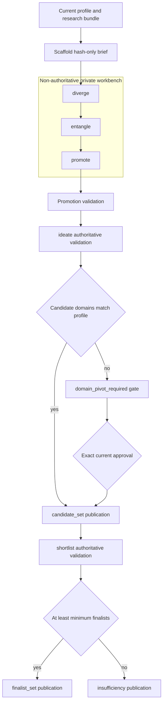

# Ideation Workbench, Candidate Publication, and Shortlisting

This workflow deliberately separates **creative exploration** from **authoritative workflow state**. The private workbench can retain many rough ideas and their relationships without making any one of them a candidate. Only `ideate` publishes a validated `candidate_set`; only `shortlist` publishes a `finalist_set` or the explicit `insufficient_evidence` result.

Use this workflow after the profile is ready and research has produced a current `research_bundle`. See [Profile and Run Bootstrap](profile-and-run-bootstrap.md) for the profile/run prerequisites, [Research and Evidence Intake](research-and-evidence-intake.md) for evidence provenance, and [State and Provenance Kernel](../architecture/state-and-provenance-kernel.md) for revision and transition behavior.



The flow separates exploratory `diverge`, `entangle`, and `promote` records from the authoritative `ideate` and `shortlist` publications.

## Authority boundary and entrypoints

The workbench is a private, file-based aid, not a second state machine. Initialize it or validate it with the read-only workbench mode:

```text
patent-factory scaffold ideation-workbench --run RUN --run-id RUN_ID --profile-database PROFILE_DB --out WORKSPACE/requests/ideation/RUN_ID/brief-v1.json --workspace-root WORKSPACE
patent-factory scaffold ideation-workbench --run RUN --run-id RUN_ID --profile-database PROFILE_DB --validate WORKBENCH --stage diverge --workspace-root WORKSPACE
```

`--validate` requires exactly one stage: `diverge`, `entangle`, or `promote`; it uses read-only run and profile database connections and returns counts, derived candidate IDs by input index at promotion, and non-blocking advisories. It does not publish a revision, open a gate, or advance run state. The separate publication commands are:

```text
patent-factory ideate --run RUN --run-id RUN_ID --profile PROFILE_EXPORT --profile-database PROFILE_DB --input CANDIDATE_INPUT --workspace-root WORKSPACE
patent-factory shortlist --run RUN --run-id RUN_ID --input SHORTLIST_INPUT --workspace-root WORKSPACE
```

Treat IDs, hashes, evidence references, and approvals as supplied bindings—not blanks to be fabricated. `scaffold candidate` and `scaffold shortlist` derive clerical bindings from current state, but intentionally leave judgment fields as `TODO(agent):` markers. A scaffold is not approval and does not make its draft publishable.

## The minimized brief and private workspace

`scaffold_ideation_brief` derives `brief-v1.json` from the authoritative profile, current research bundle, and evaluation configuration. Its `brief_id` binds the normalized body. The brief contains:

- the run, profile revision, research revision, and evaluation-config bindings;
- profile **cards** with field name, claim IDs, problem/capability kinds, and a hash of the value—not the profile value itself;
- evidence cards with evidence ID, content/record/metadata/excerpt/span hashes and limited metadata, marked `hash_only_private_boundary`;
- hashes of research coverage limitations as `semantic_gaps`; and
- optionally, a re-ideation seed that preserves the checkpoint/finalist identities and hashes feedback rather than exposing its semantic text.

The egress object is deliberately fixed: egress is disallowed, recipient is `null`, scope is `local_cli_only`, and semantic content is unavailable. Profile fields associated with credentials, contact information, names, raw documents, and secrets are excluded from cards. Initialization creates private `sessions/` and `promoted/` directories alongside `brief-v1.json` and `notes.md`; when a changed brief replaces an old one, the prior content is retained under `history/brief-HASH.json`. Old work can therefore still identify the brief it used without silently being rebound to new context.

The local workbench is still a privacy boundary, not a place to copy secret values. Candidate and shortlist submission also scan supplied payloads and profile context for configured credential values before any publication.

## Diverge first: record raw ideas without promoting them

A divergence session writes `sessions/SESSION_ID/ideas.jsonl`. An `idea-node-v1` is explicitly a `creative_suggestion`, has a raw `idea_id` that must **not** use the `ca_` candidate namespace, and records a lens, technical problem, rough mechanism, inputs, transformations, outputs, validation approach, limitations, optional evidence IDs, and optional profile references.

Validation at the `diverge` stage requires at least one real session and rejects symlinks, placeholders, duplicate idea IDs, malformed fields, unknown evidence IDs, and unknown profile claim identities. Each idea must bind a known current or archived brief; at least one idea must bind the current brief. This permits historical sessions to remain inspectable after a brief refresh while preventing a workbench made entirely from stale context.

No quality score, finalist rank, or candidate identity belongs in a raw idea. Raw ideas are working material, so they never become authoritative state solely by being written or validated. The advisory output may flag a single-lens workbench, but it does not reject the work or choose a direction.

## Entangle: make creative relationships inspectable

At `entangle`, add at least one `idea-relation-v1` record and one `idea-clusters-v1` document. Relations may be `combines`, `contrasts`, `derives`, `parks`, or `revises`; their source/target cardinalities make the intended operation explicit. The directional operations (`combines`, `derives`, and `revises`) form an acyclic graph. Clusters must name known ideas and give a rationale.

This stage is about retaining alternatives and provenance of combinations, not reducing the graph to a winner. Validation also reports—not blocks—smells such as multiple sessions with no cross-session relation. The workbench supplies the trace that later explains a candidate, but its relations are not state transitions.

## Promote: validate the bridge and its lineage

Promotion supplies two files under `promoted/`:

- `candidate-input-v1.json`, the same kind of input later passed to `ideate`; and
- `lineage-v1.json`, an `idea-lineage-v1` ledger whose `candidate_input_hash` must equal the promoted input hash.

Promotion is read-only validation, but it is deliberately strict. It rejects any remaining `TODO(agent)` anywhere in the promoted input or lineage; validates the candidate input against the **current** profile, research, and evaluation configuration; and permits at most 12 candidates. Each candidate index must appear exactly once in lineage. Its sources must be known ideas, its listed session IDs must exactly equal those ideas' sessions, its relation IDs must exist, and at least one source idea must bind the current brief. These rules prevent an attractive candidate draft from being detached from the creative work or silently justified only by a historical brief.

Passing `promote` demonstrates readiness; it does not call `run_ideation`. Submit the promoted candidate input through `ideate`, which revalidates it against authoritative state before publication.

## Candidate publication and the domain-pivot gate

`ideate` accepts research-complete or research-incomplete runs, but first compares the supplied profile export with the authoritative profile database. It then constructs each `candidate-v1` deterministically from content and binds it to the current profile revision, research revision, and evaluation configuration.

A publishable candidate must carry a complete technical proposal and an auditable support model:

- It has distinct authoritative profile references covering both a `problem` and a `capability`; the referenced claim must exist in the authoritative profile and match the stated kind.
- It has at least one current evidence reference. Each reference must name the exact evidence revision by content hash and either a span owned by that evidence record or an explicit limitation.
- Its field-level claims identify their field and epistemic label. The technical problem, mechanism, expected effects, and synthesis trace require labels; at least one claim must be a `creative_suggestion`. A `source_fact` or `source_inference` must bind the same evidence ID, content hash, and span as a candidate evidence reference.
- Its `synthesis_trace` records an allowed method—`modify`, `combine`, `adapt`, `constrain`, or `transfer`—and can cite only evidence already cited by the candidate.

After validation, candidates are ordered by deterministic `candidate_id`, the system publishes a `profile_context`, ideation context, and then the `candidate_set`, transitioning through `ideation_running` to `candidates_ready`. The publication depends on the current profile context and research revision, is exported privately, and is idempotent for the same request. A replay that matches a previous publication but does not leave the run in `candidates_ready` is rejected rather than reported as success.

### Domain pivot means exact approval, not a broad permission

The canonical domain is the profile's `technical_domain`. If **any** candidate proposes a different domain, `ideate` does not persist a `candidate_set`. Instead it creates a `domain_pivot` gate and moves the run to `domain_pivot_required`. Its scope binds the old-domain hash, all proposed new-domain hashes, the profile/research/configuration hashes, and a fingerprint of this exact candidate request.

Resuming requires a supplied `domain_decision_id` that is an un-stale `approve` decision for the same request revision hash, suspended operation, and approval scope. The decision is consumed for that exact publication; an identical idempotent replay is the only reuse path. Editing the candidates, changing bindings, using a decision for another operation, or inventing an approval requires a new gate rather than permitting publication.

## Shortlist on three fixed, evidence-backed axes

`shortlist` reads the current `candidate_set` and research bundle. The request must partition **every** published candidate into a selected finalist or an explicit exclusion with rationale and reason codes. It never creates candidates or fills in a judgment automatically.

Every selected finalist is evaluated on exactly these three preliminary axes, once each:

1. `differentiation`
2. `technical_feasibility`
3. `utility_significance`

For each axis, the input must use the configured rubric version, give an integer score from 0 through 100, confidence (`low`, `medium`, or `high`), rationale, coverage assessment and limitations, gaps, and at least one supporting evidence reference. Supporting and contrary references must be current research evidence already traced by that candidate. The output binds each finalist to the exact candidate-set revision hash. Finalists are deterministically ordered by `(priority, candidate_id)`, then receive a one-based rank and hash-derived `finalist_id`.

The default configuration fixes `minimum_finalists` at 3 and fixes those three rubric names. Three is a minimum, not an automatic choice of the first three candidates: defensibility still depends on filled evaluations and evidence. CLI advisories can flag flat axis scores or near-identical finalist score vectors, but they do not override the submitted choice.

### Explicit `insufficient_evidence` branch

When fewer than three finalists are selected, `insufficiency` is required instead of a finalist publication. It must state the structurally eligible selected IDs, rejected IDs (which must have exclusions), reason codes, missing evidence, limitations, unresolved questions, and recommended research. The result publishes an `insufficiency-v1` artifact, reaches `insufficient_evidence`, returns no finalist IDs, and leaves no current `finalist_set` pointer. The CLI reports this outcome with status `insufficient_evidence` and exit code 5.

Conversely, three or more selected finalists require `insufficiency: null` and publish `finalist-set-v1` to `finalists_ready`. This makes lack of sufficient support an explicit, actionable result—not a disguised short list or an invented third finalist.

## Failure handling and focused verification

Validation errors occur before the relevant authoritative publication: forged profile exports, stale/mismatched profile context, unknown evidence, forged source spans, duplicate candidate or finalist selections, incomplete axes, placeholder text in promotion, and lineage disagreements all fail closed. The workbench also rejects unsafe symbolic links and over-budget JSON inputs.

The integration coverage in `test_g004_ideation_and_shortlist.py` checks exact domain-gate binding and one-time consumption, deterministic/idempotent publication and dependency edges, candidate/profile/evidence rejection paths, the three-axis rule, and the no-finalist `insufficient_evidence` branch. `test_g011_ideation_workbench.py` checks hash-only brief contents, read-only stage validation, brief history, relation-cycle rejection, promotion bounds, TODO rejection, and lineage/session binding.

For what happens after a finalist set exists, continue to [Similarity Audit and Human Checkpoint](similarity-audit-and-human-checkpoint.md). For workspace containment and scaffold file handling, see [CLI, Private Workspace, and Scaffolds](../operations/cli-private-workspace-and-scaffolds.md). For broader data-boundary rules, see [Privacy and Authority Boundaries](../concepts/privacy-and-authority-boundaries.md).
