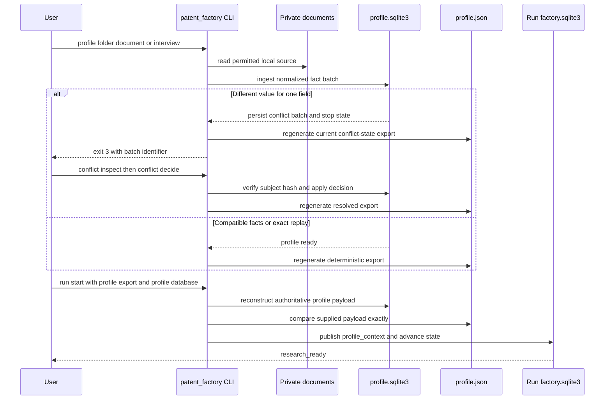

# Profile Ingestion and Run Bootstrap

This workflow is the boundary between private inventor material and an auditable research run. It converts local notes or interview answers into normalized profile facts with provenance, stops rather than guesses when values disagree, and then freezes the exact ready profile into a run-local `profile_context` artifact.

> **Authority rule:** `workspace/profile.sqlite3` is the authoritative profile state. `workspace/profile.json` is only its deterministic export. **Change neither by hand; use the `patent_factory` CLI for every profile ingestion, conflict decision, and export.** The CLI regenerates the JSON from SQLite, and `run start` rejects an export that differs from the database.

A profile is reusable private state. A run is a separate, scoped research history. The run receives a hash-bound snapshot, not ownership of the profile database.



The sequence shows both the conflict gate and the second authority check performed before a profile can enable research.

## Stores, roles, and the non-negotiable separation

| Location | Role | Operator rule |
| --- | --- | --- |
| `documents/` | Private source material and optional scripted interview responses. Everything other than its README is ignored by Git. | Keep profile source files here; placing a file here does not authorize external sharing. |
| `workspace/profile.sqlite3` | **Authoritative profile database**. It retains facts, claims, ingestion batches, unresolved conflicts, state, conflict decisions, and the derived profile revision. | Do not open it as an editing surface. Use `profile` subcommands. |
| `workspace/profile.json` | Deterministic, atomically written projection of the authoritative payload: profile version, revision, state, conflicts, facts, and ordered claims. | Do not patch it. A profile command will overwrite a tampered copy from SQLite. |
| `workspace/runs/RUN/factory.sqlite3` | **Separate run database** for the run state machine, artifact revisions, exports, transition events, and research results. | It must not be the profile database. A run is bound to one run ID and its context snapshot. |
| `workspace/runs/RUN/bootstrap-exports/` | Owner-only immutable export of the run's `profile_context` artifact. | Treat it as a registered run artifact, not a replacement for either database. |

Although the database module owns schema and connection logic for both profile and run state, `run start` explicitly rejects a `factory.sqlite3` path that is the same file as the authoritative profile database. This separation lets profile facts be maintained independently while each run records the exact snapshot it used.

## Entry points and normal operating path

Initialize the private roots once, then choose one ingestion path. Defaults put the profile database and export under `workspace/`.

```bash
python3 -m patent_factory init

# Recursively ingest all supported files under the selected folder
python3 -m patent_factory profile folder documents

# Ingest one supported source file
python3 -m patent_factory profile document documents/background.md

# Ask at a terminal, or use a reproducible JSON response object
python3 -m patent_factory profile interview
python3 -m patent_factory profile interview --responses documents/interview.json
```

The common profile options are `--documents-root`, `--workspace-root`, `--database`, and `--profile`. Inputs must be under the documents root; profile outputs and conflict-decision inputs are under the workspace root. The CLI rejects a configuration that uses the same path for `--database` and `--profile`.

### What may be ingested

| Source form | Accepted representation | Fact extraction and provenance |
| --- | --- | --- |
| Markdown or text | UTF-8 `.md` or `.txt` | Nonempty, non-comment `field: value` lines become facts. The default claim is `source_fact`. |
| JSON document | UTF-8 `.json` object, or an object with a `facts` array | A plain object maps each key to a value. A `facts` array can supply field/value entries and explicit valid claim metadata. Plain-object items receive `source_fact` claims. |
| Folder | A recursive tree containing supported regular files | Traversal is lexical by entry name, so the collected order and source identities are stable. Unsupported suffixes are skipped, but links and other non-regular entries are rejected. |
| Interview | Interactive terminal answers, a JSON response file under `documents/`, or `--responses -` | Nonempty answers are sorted by field and receive `user_statement` claims with source ID `interview-v1`. Noninteractive use without `--responses` is rejected. |

The accepted suffix set is exactly `.json`, `.md`, and `.txt`; PDF, DOCX, and images are not parsed. Each document must be UTF-8, a regular file, at most 2,000,000 bytes, inside the selected root, and free of symbolic-link traversal. These rules apply to the input itself and folder descendants, preventing a profile operation from silently reading outside the private input boundary.

### What makes a profile fact claim-backed

A persisted fact has one canonical value and one or more claims. The claim is not decorative metadata: it identifies the epistemic class and binding material that downstream code checks.

- For ordinary document extraction, `source_fact` is a quoted source claim. Its generated `src_...` source ID incorporates the root-relative locator and content hash; it also carries a content hash and a hash of the source span. Thus moving or editing a document makes a distinguishable source identity rather than silently reusing the old binding.
- Interview answers are `user_statement` claims. This label requires a source ID and is represented as a quote, but it does not pretend to be a document span.
- An explicit claim in a JSON `facts` array is validated under the same `Claim` rules. In particular, `source_fact` and `source_inference` require source ID, content hash, and span hash; inference labels also require rationale. The broader claim vocabulary does not make an unsupported source valid.
- A resolved conflict adds a `user_statement` claim tied to the recorded resolution ID for the selected value. This preserves the fact that a person made the selection rather than presenting it as an automatic source extraction.

Fact fields and values are NFC-normalized and compared using canonical JSON. Claim IDs derive from normalized claim content, so their meaning and identity are stable across equivalent input formatting.

## Ingest, replay, and export

The ingestion unit is a **batch**, not an individual field update. The core normalizes every incoming fact, hashes the input mode and normalized batch to form an `ib_...` batch ID, and performs the check and write in an immediate SQLite transaction.

1. For a new compatible batch, the database inserts missing fact values and nonduplicate claims, computes the profile revision from sorted facts and claims, and sets the profile to `profile_ready` unless an older conflict remains.
2. For an already recorded identical batch, the core returns the earlier result with `changes: 0`. It does not add a second batch, claim, or conflict. Re-running `/setup` or a raw `profile` command is therefore safe for unchanged input.
3. After either path, the CLI calls `export_profile`. The export rebuilds its payload by ordering fields and claim IDs from the database, serializes stable JSON keys, and atomically replaces `profile.json` with an owner-only file.

The export is intentionally recoverable rather than independently editable. For example, re-ingesting the exact same document after manually corrupting `profile.json` reports zero changes but restores the canonical value from `profile.sqlite3`. If an operator needs to inspect profile state, the JSON export is the supported readable view; do not create a second writer that bypasses the CLI.

## Conflict gate: stop the whole batch, then decide the exact subject

A disagreement is any canonical-value difference for the same field—against an existing fact or earlier item in the same incoming batch. It is not a last-write-wins update.

When one conflict is found, the transaction records the ingestion batch and conflict rows, retains the existing canonical profile facts, sets `conflict_resolution_required`, and applies **none** of that batch's otherwise compatible facts or claims. The command exits with code `3`; its conflict record identifies the field and hashes of the existing/incoming values, while the export retains only the already canonical facts rather than accepting the incoming conflicting value. This is why a batch containing one changed `name` and one new `technical_domain` leaves neither change in canonical profile facts.

Inspect the conflict that the CLI identified, author a decision under the workspace root, and submit that exact decision:

```bash
python3 -m patent_factory profile conflict-inspect --batch-id BATCH_ID
python3 -m patent_factory profile conflict-decide --batch-id BATCH_ID --input DECISION_JSON
```

`conflict-inspect` returns the pending conflict IDs and a `subject_hash` over the current batch subject. A `profile-conflict-decision-v1` input must name that batch and subject hash, contain a nonempty `actor` and `reason`, and use one of these actions:

| Action | Required choices | Result |
| --- | --- | --- |
| `choose_source` or `choose_value` | Exactly one `{conflict_id, selected}` entry for every current conflict, with `selected` equal to `existing` or `incoming` | Updates each selected canonical fact, appends the resolution claim, removes that batch's conflicts, and becomes `profile_ready` only if no other conflicts remain. |
| `retain_unresolved` | None | Retains the old values and all conflicts; the profile remains `conflict_resolution_required`. |
| `stop` | None | Preserves the unresolved history and marks the profile `stopped`; later ingestion is refused. |

A stale subject hash, an incomplete/duplicate choice set, a mismatched batch ID, or a changed replay decision fails before mutation. The same submitted decision can be replayed and reports the retained result; a different decision for a previously decided batch is rejected. Resolve every open conflict before attempting `run start`—there is no automatic conflict-to-run bridge.

## Bind a ready profile into a run

Once the profile is ready, bootstrap a fresh run with both representations of the profile:

```bash
python3 -m patent_factory run start \
  --run workspace/runs/example --run-id example \
  --profile workspace/profile.json --profile-database workspace/profile.sqlite3
```

The CLI first validates the profile, before it creates or mutates the run directory:

1. It reads the supplied JSON object and reconstructs the authoritative payload from `profile.sqlite3`.
2. It rejects the start unless canonical JSON for those two payloads is exactly equal. A hand-edited, stale, or incomplete export cannot be substituted for database state.
3. It also requires `profile_version: "profile-v1"`, `state: "profile_ready"`, no conflicts, a facts mapping, and a nonempty authoritative `profile_revision`. Credential canaries are checked before the profile is published into run state.
4. It derives a digest of the authoritative payload and creates `profile_context-v1`, containing the full authoritative profile, its revision ID, and its revision hash.

Only after this preparation does the run state machine create or reuse the contained, private run directory and its distinct `factory.sqlite3`. The start operation records these transitions in order:

```text
new -> profile_pending -> profile_ready -> research_ready
```

The last transition publishes `profile_context` as a current run artifact and registers an immutable JSON export below `bootstrap-exports/`. Its transition evidence includes the profile hash. A successful result reports the artifact ID, event IDs, profile revision, export path, and `research_ready`; only then can the research workflow begin.

### Idempotency and recovery at bootstrap

The run-start idempotency identity is the normalized run ID plus the authoritative profile hash. Repeating the same start returns the original creation, transition, artifact, and export records instead of duplicating them. A run database is also constrained to one run ID, so a second identifier cannot quietly share its history.

Artifact publication is registered with the run state transition. If a failure occurs while publishing `profile_context`, the transition does not report research readiness; the run remains at the earlier valid state and the export recovery logic can reconcile the orphaned file on retry. Do not work around this with manual file copying or direct database repair—retry the exact CLI command after correcting the operational problem.

## Downstream meaning of `profile_context`

`research_ready` means the run has a verified profile snapshot; it does **not** make the profile mutable through the run. Later ideation still opens the authoritative profile database, checks a supplied export against it, validates profile claims, and refuses to continue if the run's current `profile_context` differs from the newly reconstructed snapshot. Candidate validation derives problem/capability categories from validated profile claim identities, not from unbound text supplied by an agent.

This has two practical consequences:

- Keep the profile stable while using a run. A changed profile revision is a different context, not a harmless edit to a JSON file.
- Use the normal profile CLI and begin or intentionally re-establish the appropriate workflow context when profile facts change. Do not attempt to replace a run's `profile_context` by editing an artifact export.

Continue with [Research and Evidence Intake](research-and-evidence-intake.md) once the run is `research_ready`. [Ideation Workbench, Candidate Publication, and Shortlisting](ideation-and-finalist-selection.md) explains how profile claim IDs later support candidate references.

## Operational failure guide and safe changes

| Symptom | Meaning | Safe response |
| --- | --- | --- |
| `conflict_resolution_required`, exit `3` | At least one incoming value differs and the whole batch was withheld. | Inspect the reported batch, author a complete exact decision, and run `profile conflict-decide`; or explicitly retain/stop. |
| Re-run reports `changes: 0` | The normalized batch was already accepted or replayed. | This is the expected idempotent outcome; inspect the regenerated export rather than forcing another write. |
| `run_start: supplied profile export does not match authoritative profile database` | The export is stale, altered, or from another profile database. | Regenerate it through a profile CLI command and retry with the matching database. |
| `run_start: authoritative profile must be current and profile_ready` | The database has no ready, conflict-free profile. | Finish profile ingestion/conflict resolution; never force run state. |
| Profile/run paths collide or leave their roots | The containment and database-separation checks failed. | Use repository-relative contained paths and distinct `profile.sqlite3` and `factory.sqlite3` locations. |

When extending this area, preserve the guarantees rather than only the command syntax: new source formats need deterministic parsing, safe containment, stable source/claim bindings, batch-level conflict behavior, and focused idempotency tests. A change to profile payload shape, canonicalization, claim IDs, or revision hashing changes the value that `run start` verifies and the snapshot downstream artifacts bind. Update the writer, verifier, migration behavior, and end-to-end replay tests together.

## Focused verification

- `tests/unit/test_profile.py` covers repeat ingestion, atomic conflict behavior, lexical recursive folder traversal, source identities, and link/nonregular-file rejection.
- `tests/integration/test_cli_profile_paths.py` covers all three CLI input paths and labels, deterministic exports, no partial batch writes, conflict inspect/decision/replay, export restoration from SQLite, and path/size safeguards.
- `tests/integration/test_g006_profile_conflicts.py` exercises stale or partial decisions, mixed selections, retain/stop behavior, transactional rollback, and migration recovery for conflict-resolution history.
- `tests/integration/test_g008_cli_core.py` verifies exact run-start replay, `new -> profile_pending -> profile_ready -> research_ready`, artifact registration and export permissions, rejection before run residue for bad/non-ready profiles, and recovery after profile-context publication failure.

For the broader persistence and transition model, see [State and Provenance Kernel](../architecture/state-and-provenance-kernel.md). For local-only handling and human authority boundaries, see [Privacy and Authority Boundaries](../concepts/privacy-and-authority-boundaries.md) and [CLI, Private Workspace, and Scaffolds](../operations/cli-private-workspace-and-scaffolds.md).
