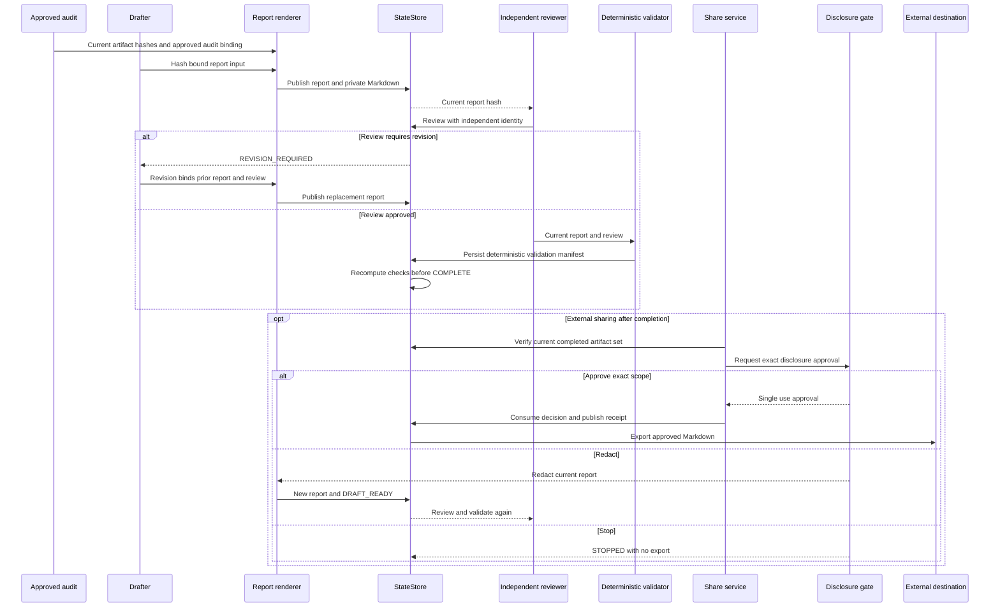

# Report Publication, Independent Review, Validation, and Sharing

This is the final private-workflow path from an approved similarity audit to a completed report and, only afterwards, to an externally released copy. It is deliberately a chain of hash-bound artifacts rather than a Markdown-writing convenience:

1. `draft` renders a language-specific, fixed 11-section `report-v1` from current approved artifacts.
2. `review` records a separate person's or agent pass against that exact report.
3. `validate` reconstructs and checks the report deterministically, then asks the state kernel to complete the run.
4. `share` is a separate disclosure operation. It requires a completed private chain and an approval for one exact recipient, purpose, destination, content, and field set.

The CLI routes `draft`, `review`, `validate`, and `share` into these workflow entrypoints; their inputs are contained under the private workspace before the core is called. A Markdown file or SQLite row edited by hand is not a report publication, review, validation, or release.

> **Legal boundary.** The report and its similarity audit organize invention research and evidence; they are not legal advice. Neither a similarity value nor report prose may make an unqualified conclusion about patentability, novelty, inventive step, validity, non-infringement, or freedom to operate (FTO). Decisions that require those conclusions belong with qualified patent counsel.

## Publication-to-release flow



The sequence shows the authoritative binding boundaries: rendering needs current approved inputs, review is a new independent artifact, completion rechecks rather than trusting status text, and an external export is a distinct approved operation.

## Bound report contract

### Request and source-artifact preconditions

`publish_report()` accepts a strictly shaped report input. The legacy `report-input-v1` means Korean; `report-input-v2` adds `language`, which must be `en` or `ko`. In both forms the input names the drafter (`id`, `pass_id`, and `agent` or `human` type), an ISO date, selected profile fields, non-empty handoff questions and recommended investigations, optional revision bindings, and any sensitive disclosures. The report scaffold is the safe starting point because it generates `report-input-v2`, preselects only non-forbidden technical profile fields, and leaves the judgment prose as `TODO(agent)` placeholders to be completed.

Before rendering, the workflow loads **current, non-stale** revisions for these eight inputs:

- `profile_context` and `research_bundle`;
- `candidate_set` and `finalist_set`;
- `corpus_set`, `feature_map_set`, and `scorer_config`; and
- `audit_batch`.

There must be at least three finalists. The audit must bind exactly to the current finalist, corpus, feature-map, and scorer revisions; it is revalidated with the authoritative similarity configuration; it must have one result per current finalist/candidate pair; and no result may remain `coverage_insufficient`. Where the approved audit required a checkpoint or excessive-similarity resolution, the renderer also requires the one current, fully consumed decision bound to that audit. These checks prevent a report from laundering stale evidence or a decision from a different audit into polished prose.

### Policy, template, and language bindings

The renderer does not merely choose translated headings. It selects a language-specific policy and template, stamps their hashes into the artifact, and refuses policy files that differ from the frozen `report-policy-v1.0.0` contract. The policy fixes the section order, mandatory report and similarity disclaimers, the review checklist, and prohibited unqualified phrases. The artifact validator in turn verifies the template hash, policy hash, one H1, and the ordered H2 structure recreated from the template.

| No. | English heading | Korean heading |
| --- | --- | --- |
| 1 | Document Purpose, Scope, and Disclaimer | 문서 목적·범위 및 면책 |
| 2 | Inventor Technical Background and Domain Context | 사용자·발명자 기술 배경 및 도메인 맥락 |
| 3 | Problem and Opportunity Areas | 문제 및 기회 영역 |
| 4 | Research Scope and Method | 조사 범위 및 방법 |
| 5 | Key Prior-Art Landscape | 핵심 선행기술 환경 |
| 6 | Final Candidates | 최종 후보 |
| 7 | Candidate Comparison Matrix | 후보 비교 매트릭스 |
| 8 | Final KIPRIS Similarity-Risk Audit | 최종 KIPRIS 유사도 위험 감사 |
| 9 | User Decisions at Similarity Checkpoints | 유사도 체크포인트 사용자 결정 |
| 10 | Patent-Attorney Handoff Questions and Follow-Up Investigations | 변리사 인계 질문 및 후속 조사 |
| 11 | Source and Evidence Appendix | 출처·근거 부록 |

The English and Korean templates each contain exactly one placeholder for every numbered section. `render_report_markdown()` replaces those placeholders only after receiving eleven non-empty bodies and rejects unresolved template tokens. English support is not a translation post-process: it uses the English policy, headings, template, disclaimer text, lexicon, and redaction marker; Korean uses its corresponding frozen resources.

### What the 11 sections mean

The renderer derives each body from a bounded input rather than allowing arbitrary report narrative:

- **1–2:** date, tool/policy version, purpose and legal disclaimer, followed by privacy-minimized selected technical profile facts and their provenance labels/source IDs.
- **3–5:** candidate problem hypotheses, recorded research method and limitations, then the cited prior-art landscape.
- **6–7:** finalists, their stated mechanisms and evidence-bound assessment rationales, closest retrieved references, descriptive feature differences, and candidate comparison prose. Axis numbers are intentionally not presented as a novelty or patentability score and do not order candidates.
- **8–9:** the provisional similarity disclaimer, audit configuration and result details, plus the complete user checkpoint action, reasons, warnings, and feedback when a decision exists.
- **10–11:** caller-supplied counsel handoff questions and bounded follow-up investigations, then a source/evidence appendix.

The selected profile fields are an explicit privacy boundary. The renderer rejects fields with sensitive names such as `email`, `name`, `phone`, `credential`, `secret`, or `raw_document`; every selected field must exist in the current profile and carry authoritative provenance claims. Sensitive disclosure input is different: it identifies report text that is intentionally present in the private report, with a field, reason, and text hash, so the later sharing gate can identify exactly what would be disclosed.

### Citations and epistemic labels

A citation is an evidence identity, not a decorative URL. The report collects IDs referenced by candidates, finalist axes, and audit pair scores; it resolves each ID against current evidence; and it records citation metadata including content hash, identifier, title, source type, observation date, limitations, and canonical URL. The sorted `appendix_ids`, citation records, citation tokens in Markdown, and Section 11 appendix tokens must describe the same set exactly.

Candidate citations are rendered at the field level. Lines labelled `[candidate hypothesis]`, `[creative suggestion]`, `[profile-based inference]`, or `[hypothesis]`—and their Korean equivalents—are explicitly unsupported proposals or inferences, so the renderer suppresses prior-art citation tokens on those lines. Validation independently rejects any hedged rendered line that nevertheless carries such a token. This distinguishes retrieved evidence from a candidate idea without implying that an unhedged description is a legal conclusion.

### Publication result and private materialization

From `audit_approved`, `publish_report()` emits `report-v1`, its Markdown export, dependency edges to the eight bound inputs, and transitions to `draft_ready`. Reports are exported to the run's `report-exports` directory, which must be a safe non-symlink owner-only directory. `StateStore.publish_transition()` supplies the immutability, export registration, transaction, and idempotency behavior; an identical active request can replay, while a changed request competes as a new publication.

The report artifact is intentionally richer than Markdown. It retains the `bindings`, language, hashes for policy/template/draft specification, sections, reconstructed Markdown, citations and appendix IDs, drafter identity, redaction history, revision lineage, and sensitive-disclosure records. Consumers should use the artifact and registered export, not infer provenance from visible prose alone.

## Independent review

### Reviewer contract

`run_review()` begins from the current private report. The review input has an exact `review-input-v1` shape and must identify a reviewer whose **both** `id` and `pass_id` differ from the report's drafter. The reviewer supplies the seven policy-ordered checks:

1. `citation_integrity`
2. `decision_gate_coverage`
3. `factual_grounding`
4. `internal_consistency`
5. `legal_language`
6. `schema_completeness`
7. `source_coverage`

It also records findings, evidence corrections, prohibited-language findings, an audit-bound decision-gate verification, and a disposition. The disposition is derived, not freely asserted: any failed check, blocking finding, evidence correction, prohibited-language finding, or failed decision-gate verification yields `revise`; otherwise it is `approved`. Advisory findings alone may accompany approval.

The reviewer must bind the current report hash, reproduce its policy hash and complete source bindings, bind the report's audit hash, and cover exactly the current finalist IDs whose audit outcome is `decision_required`. Before accepting any caller-authored review assertion, the workflow validates the report artifact and runs the deterministic legal-language scanner itself. A checked “pass” box cannot override an unsafe sentence in the report.

An approved review becomes `review-v1` and moves `draft_ready` through `review_required` to `reviewed`; a revision disposition moves the run to `revision_required`. The review is dependent on the report revision, so replacing the report makes that review stale.

### Revision loop

A normal report revision is allowed only from `revision_required` and must carry a `revision` object containing the reason and hashes of the **current** report and review. It is accepted only when that current review requires revision or when the current report/review pair has a failed validation manifest. The replacement report is rendered again from current source artifacts; it is not a manual patch to the prior Markdown. The new report returns the workflow to `draft_ready`, from which it needs a fresh independent review and validation.

This gives evidence corrections and blocking findings an operational consequence: they cannot be cleared by overwriting a disposition string. They require a new artifact whose dependencies, content hash, policy/template bindings, citations, and later review all correspond to the replacement report.

## Deterministic validation and completion

### Nine recorded checks

`validate_and_complete()` runs only after an approved review. It builds `validation-v1` with a fixed ordered result for all nine checks, catching each check failure so the manifest explains which controls failed:

| Check | What it establishes |
| --- | --- |
| `artifact_bindings` | Every report binding still points to the current source revision, including an applicable decision resolution. |
| `citation_integrity` | Tokens, appendix, and current evidence metadata agree; no hedged line cites prior art. |
| `decision_coverage` | Section 9 contains the current checkpoint/excessive decision, warnings, and checkpoint feedback where applicable. |
| `identifier_shape` | Citation identifiers normalize as patent numbers and supplied URLs are safe HTTPS URLs. |
| `legal_language` | Sentence-local scanning rejects unqualified legal conclusions. |
| `narrative_language` | Every section contains narrative in the declared English or Korean language; source titles and IDs may retain their source language. |
| `report_structure` | The report still conforms to its strict `report-v1` content, policy, template, heading, disclaimer, and citation contract. |
| `review_binding` | The current review is approved, hash-bound to this report, all its checks pass, and it has no unresolved blocking/correction/prohibited-language item. |
| `semantic_reconstruction` | The validator rebuilds the expected report from current artifacts, stored structured draft input, and recorded redactions, then requires exact equality. |

The reconstruction check is the key defense against a structurally valid but hand-altered report. It rebuilds the report payload through `_report_payload()` from the report's `draft_spec`, `drafter`, date, revision lineage, sensitive disclosures, and redactions; an added claim, changed comparison rationale, reordered content, or altered closest reference does not match the canonical reconstruction.

A manifest with any failed check is persisted and returns the run to `revision_required`. Only an all-pass manifest reaches `validated`. The resulting artifact includes the report/review hashes, source artifact hashes, policy/scoring/workflow/schema versions, validator version, and all check details, making it a reproducibility record rather than a bare Boolean.

### Completion is a second enforcement point

Completion is not granted merely because `validate` wrote `status: passed`. When a transition targets `complete`, the state kernel reads the current report, review, and validation artifacts; recomputes their semantic hashes; revalidates their schemas and bindings; rebuilds the validation manifest; verifies an approved review and passed validation bound to the current report; checks required report-to-review-to-validation dependency edges; and verifies that report source bindings remain current. A forged validation record, a detached dependency edge, or an upstream change cannot cross this boundary.

## Sensitive disclosure, redaction, and external sharing

### Exact-scope disclosure gate

A private `complete` report is not automatically deliverable to anybody. `share` takes an `external-report-share-v1` request with `destination`, `recipient`, `purpose`, current `report_hash`, and the sorted exact `sensitive_fields` set. It refuses a non-current report hash or a field list that differs from the current report's sensitive disclosure list.

For a matching request, the share service constructs a scope containing all of the following:

- a rendered Markdown content hash and the current report, review, and validation hashes;
- the exact recipient, purpose, and normalized destination; and
- every disclosed field with its reason and text hash.

Without an existing matching approval, it suspends the run at `sensitive_disclosure_required` and raises `SensitiveDisclosureRequiredError`; the CLI reports the available actions `approve`, `redact`, and `stop`. The gate is bound to the exact report revision and suspended share operation. Changing even one of the content hash, recipient, purpose, destination, or fields means the scope no longer matches and a new gate is required.

### Approve, redact, or stop

- **Approve:** The decision must be the current `sensitive_disclosure` `approve` decision for exactly this scope and operation. The service consumes it, publishes the Markdown into its managed external directory, and persists an `external-share-receipt-v1` containing the report hash, recipient, purpose, destination, and approval-scope hash. The state layer atomically claims `used_at` for the decision, so it is single-use. An exact already-completed share may replay its existing receipt; that is a retry, not permission to make a different release.
- **Redact:** A matching `redact` decision creates a new report revision. It replaces every declared sensitive text occurrence with the language-specific marker (`[REDACTED: sensitive information]` or `[삭제됨: 민감 정보]`) and retains a history with decision ID, prior report hash, reason, field, and text hash—not the plaintext. The old report and its dependent review and validation are stale; the run returns to `draft_ready` for fresh review and validation before another share attempt.
- **Stop:** The run reaches `stopped` and no share receipt or external Markdown is published.

The external destination is also a security boundary. It must be contained under the run's parent but outside the owner-only run and free of symlink traversal. The service owns only its `.patent-factory-shares` child, verifies it is a directory owned by the current user with mode `0700`, and leaves caller-owned neighboring destination files untouched.

## Operating the workflow safely

Use scaffolding and the CLI to create request objects and mutate the run. A typical private path is:

```text
python3 -m patent_factory scaffold report --language en --out workspace/requests/report-input-v2.json
python3 -m patent_factory draft --run RUN --run-id ID --input workspace/requests/report-input-v2.json
python3 -m patent_factory review --run RUN --run-id ID --input workspace/requests/review-input-v1.json
python3 -m patent_factory validate --run RUN --run-id ID
python3 -m patent_factory share --run RUN --run-id ID --input workspace/requests/external-report-share-v1.json
```

The final command normally stops at the disclosure gate until `gate decide` supplies a decision for the returned `gate_id`; it is then repeated with the matching `--decision-id`. A review that returns `revision_required` is a controlled work item, not an incomplete success. Likewise, a failed validation manifest is retained for diagnosis but cannot complete the run.

### Safe changes and extension points

- Treat `config/report-en-v1.0.0.json`, `config/report-v1.0.0.json`, their templates, report schema, renderer lexicon, and validators as one contract. A same-version heading, disclaimer, policy-array, template, or placeholder drift is intentionally rejected.
- Adding a language is a code-and-contract extension: `REPORT_LANGUAGES`, policy/template mappings, headings, disclaimer/lexicon resources, schema acceptance, rendering, language validation, and tests must agree. Supplying a third policy file alone is insufficient.
- Preserve the report's source bindings and revision dependencies when adding a report field. If it changes rendered semantics, make it reconstructible from stored inputs and cover it in `semantic_reconstruction`; do not introduce editable free-form output after rendering.
- Preserve the independent-review rule. Adding a review check requires coordinated policy, schema, input validation, review artifact, and deterministic validation changes, with an explicit disposition effect.
- Preserve release scope rather than broadening it. A new external delivery channel must bind its recipient/destination/purpose/content and use an authorizing single-use gate action; a direct copy of the private export bypasses the audit trail.

## Focused verification

`tests/integration/test_g007_report_review_validation.py` is the primary end-to-end executable specification. It covers the draft-review-validate CLI path; report/review/validation JSON Schema conformance; 11-section disclaimer and citation behavior; independent reviewer identity/pass; legal-language rejection despite a review checkbox; canonical reconstruction against added or altered claims; audit/result completeness; fault rollback, export recovery, tamper detection, and concurrent draft idempotency. Its sensitive-disclosure cases cover exact approval matching, redaction invalidation and re-review, stop-without-export, unsafe destinations, single-use behavior, retry receipts, and preservation of caller-owned destination files.

`tests/integration/test_g009_english_report.py` adds the English path: English headings and narrative, frozen English policy rejection, English legal-language detection, full review/validation completion, and the English redaction replacement. Together these tests protect the properties that matter most when changing reporting: deterministic reconstruction, independent review, non-legal wording, and disclosure scope.

## Related documentation

- [Transactional State, Artifact DAG, and Gates](/openwiki/architecture/state-and-provenance-kernel.md)
- [Privacy, Authority, and Legal Boundaries](/openwiki/concepts/privacy-and-authority-boundaries.md)
- [CLI, Private Workspace, and Request Scaffolds](/openwiki/operations/cli-private-workspace-and-scaffolds.md)
- [Reliability, Recovery, and Release Evidence](/openwiki/operations/reliability-recovery-and-release-evidence.md)
- [Verification Strategy](/openwiki/testing/verification-strategy.md)
- [Similarity Audit and Human Checkpoint](/openwiki/workflows/similarity-audit-and-human-checkpoint.md)
