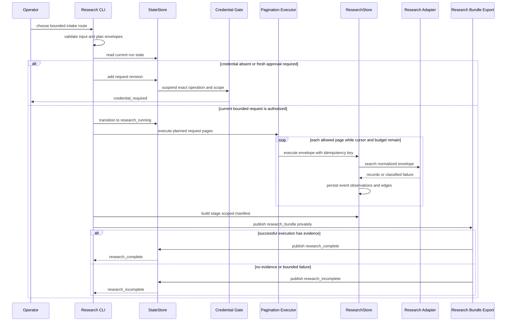

# Research Intake, Persistence, and Re-entry

Research is the workflow boundary where a bounded request becomes durable provenance. It is deliberately more than a search call: an input is normalized into a `QueryEnvelope`, executed through an adapter or local importer, persisted as observations and evidence (or as a bounded failure), and published as a current `research_bundle` with a run-state outcome.

Use this page after [Profile and Run Bootstrap](profile-and-run-bootstrap.md) has reached `research_ready`. It explains the research-stage workflow; [Research Adapters and Network Egress](../integrations/research-adapters-and-network-egress.md) documents provider contracts, while [Transactional State, Artifact DAG, and Gates](../architecture/state-and-provenance-kernel.md) describes the shared state and revision kernel. Research output later supplies evidence references to [Ideation Workbench, Candidate Publication, and Shortlisting](ideation-and-finalist-selection.md) and, after finalists exist, the [Similarity Audit and Human Checkpoint](similarity-audit-and-human-checkpoint.md).

> **Do not equate an outcome with permission.** `research_incomplete` is a persisted description of this bounded attempt, not permission to issue an expanded or live follow-up automatically. Likewise, `credential_required` is a stop at an exact request boundary, not permission to reuse an environment credential. A later live request must satisfy its current state, plan, budget, idempotency, and—where required—fresh credential-decision constraints.

## Intake routes and when they egress

All routes ultimately use the same research persistence and publication model, but they have different acquisition authority.

| Route | Primary command | Acquisition and validation | Network behavior |
| --- | --- | --- | --- |
| Deterministic fixture | `research fixture SOURCE` | Reads a byte-bounded local KIPRIS XML fixture through a fixture-only adapter. It is useful for reproducible workflow and parser testing. | None; the transport returns local bytes. |
| Reviewed manual metadata | `research manual SOURCE --allow-host HOST` | Imports a local `records` list through `ManualWebAdapter`. Records are public metadata, not raw-document uploads. | None. |
| Offline web-row normalization | `research normalize-web SOURCE --out OUTPUT --allow-host HOST --source-type TAG` | Converts a `web-rows-v1` rows file into the manual-import shape, computing deterministic span and content hashes locally. It does **not** retrieve the listed URLs. | None. |
| Live KIPRIS | `research kipris` | Plans KIPRIS keyword expansions or bibliography-summary requests, then invokes a credentialed batch runner. | HTTPS to the adapter's fixed KIPRIS allowlist only, after credential controls. |
| Live Google Patents via SerpApi | `research serpapi` | Builds one Google Patents search envelope, with local replay/state checks and optional quota preflight before a fresh search. | HTTPS to SerpApi only, after credential controls. |

For an offline web handoff, preserve the separation between collection and trusted normalization:

```text
patent-factory research normalize-web WEB_ROWS.json --out MANUAL_IMPORT.json --allow-host patents.google.com --source-type google_patents --documents-root DOCUMENTS
patent-factory research manual MANUAL_IMPORT.json --run RUN --run-id RUN_ID --query QUERY --allow-host patents.google.com --documents-root DOCUMENTS --workspace-root WORKSPACE
```

`normalize-web` accepts only a non-empty `rows` list with `schema_version: "web-rows-v1"`, a closed row schema, one approved source tag, and an explicit HTTPS host allowlist. For each row it canonicalizes the URL, hashes the supplied title plus optional abstract/excerpts, and emits records that must successfully pass the manual sanitizer again. The output is owner-only (`0600`). This normalization proves neither that out-of-band collection was authorized nor that the metadata supports a legal conclusion; retain source limitations in the input.

Manual intake is intentionally narrow. Each record requires a title, identifier, provenance, valid non-placeholder SHA-256 `content_hash`, and an HTTPS canonical URL on an allowed host. Unknown fields—including raw content, private notes, or unsupported metadata—are rejected before fingerprinting or persistence. Userinfo, fragments, unusual ports, HTTP URLs, and unedited `REPLACE_WITH`/all-zero template values are rejected as well. This keeps manual evidence attributable to a declared public-metadata source rather than silently promoting an arbitrary local document.

## End-to-end control flow



The sequence shows the authoritative ordering: a gate is recorded before gated egress; every executed page is independently persistent; and the final state is published with the bundle rather than inferred from CLI text.

## From a query term to a request identity

### Planning a bounded query set

`plan_keyword_queries()` creates `PlannedQuery` objects from the origin term and, within `ResearchBudget.max_depth`, Korean and English synonyms, discovered terms, classifications, applicants, and inventors. It normalizes, case-insensitively deduplicates, orders the terms deterministically by group, and stops at `max_calls`. `plan_bibliography_queries()` is intentionally separate because a bibliography lookup has an `application_number` projection rather than a free-text `word` projection.

A `QueryEnvelope` contains the run, adapter identity/version/capability, a single HTTPS host, timeout, page and cursor, result/byte/retry budgets, retry owner, query projection, and optional audit binding. Validation bounds the deadline to 60 seconds, results to 500, response bytes to 10,000,000, retry budget to three, and page values to the declared envelope cap. Its canonical `request_body()` includes the request-shaping fields and is hashed into an `rq_...` `request_fingerprint`. `ResearchStore` derives the stable `qu_...` query ID from the run ID and that fingerprint.

The fingerprint is the identity of a *normalized request*, not a generic search label. `ResearchStore.execute()` runs an adapter's optional `prepare_envelope()` hook before validation, fingerprinting, and idempotency lookup. This is especially important for manual input: it is sanitized before it can become a durable envelope. Provider credentials are not part of this body; the credentialed adapters add their process-only key only after fingerprinting.

### Idempotency protects both transport and provenance

Each store execution needs a non-empty idempotency key. A prior `research_operations` row with that key can replay only if its recorded `query_id` matches the newly derived query ID. A match returns the stored `ResearchExecution` without calling the adapter; a different request under the same key fails rather than being rebound. The store repeats the lookup in its immediate SQLite transaction, closing the race between a preflight read and a concurrent writer.

The runner has a second publication-level idempotency boundary. The final transition is recorded under `research.finish` for an ungated operation or under the exact credential operation for a decision-bound operation. A replay is valid only while the prior artifact remains current and its registered export is intact. In other words, retrying is not an instruction to search again: first determine whether the request is a valid replay, a fresh attempt, or an invalid key reuse.

## Paging and budget invariants

### The frozen `page_cap` and live `effective_pages` are intentionally different

`QueryEnvelope.page_cap` and `ResearchBudget.page_cap` have a frozen value of five. That value is inside `request_body()` and therefore inside every request fingerprint and suspended credential request revision. It is a replay-compatibility fossil: changing it, or letting a CLI option rewrite it, would mint different page-one fingerprints and invalidate the identity expected by pre-paging idempotency records and gates.

`research kipris --paging` therefore changes a different value: the unhashed `effective_pages` argument passed to `run_research_batch()` and `execute_paginated()`. The default is one page; the CLI turns it into the frozen maximum of five when `--paging` is present. This compatibility constraint has two consequences:

- Turning paging on must not alter the page-one envelope or its historical idempotency key.
- `effective_pages` is operationally important but invisible to `subject_revision_hash`; credential approval scopes and runtime checks must bound it explicitly.

The KIPRIS CLI refuses `--paging` when `--result-budget <= 30`, because its first page already consumes that entire result ceiling. The batch planner and the batch executor both enforce `planned query count * effective_pages <= 100` before any egress. This duplicate enforcement matters because a caller can construct `PlannedQuery` objects without using the standard planner.

### Page execution is auditable rather than implicit

`execute_paginated()` stops a query at the first of: allowed-page exhaustion, result-budget accounting exhaustion, adapter failure, or no `next_cursor`. It leaves page one untouched and reuses its base idempotency key. Later pages receive their own envelope (`page` and matching string cursor), query ID, adapter event, and `:pNN` idempotency-key suffix.

For KIPRIS, the page window is fixed once as `min(30, result_budget)`. The later-page projection keeps that `num_of_rows` constant so the provider's `(pageNo - 1) * numOfRows` offset does not move backward and re-fetch earlier rows. The `result_budget` remains the whole-query ceiling used by the loop's received-record accounting; it is not rewritten as a smaller per-page request. A full final window can therefore retrieve more rows than the accounting boundary, but it avoids gaps and duplicate windows. `byte_budget`, meanwhile, is a **per-response** limit: a multi-page batch may receive up to one byte budget for each executed page.

A credential approval for a batch makes the real wire ceiling reviewable: its scope names `effective_pages`, per-query `result_budget`, planned `query_count`, and `max_requests`. On resume, the decision check rejects a request that asks for more pages or results than approved. The pagination loop independently clamps itself to the approved values, because it creates pages two and later only after the one-time decision consume has returned.

## Persisting observations without inventing evidence

`AdapterResult` makes success and failure structurally distinct: a failed result cannot carry records, while a successful result must carry a response hash even when it returns no records. Before persistence, `ResearchStore` scans normalized records, failures, coverage, cursor, rate-limit metadata, and terms notes for configured credential canaries. It then persists an entire result in one immediate SQLite transaction:

1. `research_queries` stores the canonical envelope, fingerprint, and optional planning context.
2. `adapter_events` stores adapter identity, retrieval time, success/failure status, response hash, terms note, coverage, cursor, rate-limit information, and normalized failure data where applicable.
3. A successful record creates or reuses an `evidence_records` row, then receives a `retrieval_observations` row and a ranked `research_edges` row. A successful empty result still gets an explicit observation with no evidence ID.
4. A failed result receives a failure observation and a `coverage_limitations` row with its shared failure kind and normalized message—**no evidence record is manufactured**.
5. `research_operations` binds the idempotency key to the resulting execution only after the other rows are ready.

Evidence identity is content-addressed as `evidence_revision_id(source_locator, content_hash)`. The store collapses duplicate identities in a single adapter result and uses `(run_id, evidence_id)` conflict handling across queries and retrieval dates. It does not erase provenance: another query that finds the same evidence still produces its own observation and ranked edge. Conversely, identical content hashes from different source locators remain distinct evidence identities. Mutable legal-status metadata is kept out of the KIPRIS content-hash input so an upstream status change does not churn that identity.

A transaction fault rolls back the authoritative query, event, evidence, observation, edge, and operation rows together. A malformed fixture, timeout, rate limit, access denial, or empty response thus leaves an inspectable bounded observation rather than a half-persisted result or invented substitute evidence.

## Bundle publication and research states

`ResearchStore.manifest()` selects the research-stage rows in deterministic order. It excludes audit retrieval rows by their `audit_` planning term kind, so a later research re-entry does not accidentally export the similarity-audit corpus as ordinary research evidence. `research_bundle()` packages that scoped manifest as `research-bundle-v1` with queries, events, evidence, observations, edges, and coverage limitations.

The runner creates `research-exports/` as a private `0700` directory and asks `StateStore.publish_transition()` to publish the deterministic bundle and register its immutable export. The published artifact depends on the gated `research_request` revision when there was a credentialed request. Export bytes and their path are registered, so startup recovery can remove unregistered crash residue and reject a tampered registered file.

For a single request, the run becomes `research_complete` only when the adapter status is successful and the execution has evidence IDs. For a batch, one successful page with evidence is enough for `research_complete`; non-auth failures from other planned pages remain in the bundle as coverage limitations. If no page supplies evidence, the bundle is still published but the run becomes `research_incomplete`. This means **complete describes completion of the bounded intake plan, not proof of exhaustive coverage or a patentability conclusion**.

An `auth` result is handled differently from other adapter failures. The failed event and limitation are persisted, then the runner suspends the exact operation at `credential_required` rather than continuing as though the credential were valid. This covers both a missing credential caught before transport and a remote rejection discovered by the adapter.

## Credential gates: exact request approval, not ambient authorization

Credential-requiring adapters declare a credential name and presence; the runner requires both before running a live operation. It stores a `research_request` revision containing the plan and request body, then either consumes a supplied matching decision or suspends a credential gate. The gate binds all of the following:

- the current request-revision hash and exact `research.execute:<key>` operation;
- adapter/version, allowed host, capability, credential name, and request fingerprint;
- for a batch, the actual pages/results/request-count ceiling; and
- the state from which suspension really occurred, which is also the required return state.

An operator can inspect and resolve a pending gate with the normal gate commands:

```text
patent-factory gate inspect --run RUN --run-id RUN_ID --gate-id GATE_ID --workspace-root WORKSPACE
patent-factory gate decide --run RUN --run-id RUN_ID --gate-id GATE_ID --input DECISION.json --workspace-root WORKSPACE
```

A usable credential decision must be current, authorizing, tied to that suspended operation, revision hash, and scope, and not already consumed by a different operation. The runner consumes it once before egress and `StateStore` marks it used only when the matching bundle publication succeeds. A decision with changed terms, host, result budget, page allowance, stale revision, or operation cannot authorize a new attempt. A gate response is therefore a request for an operator decision; it does not cause the CLI to continue automatically.

## Live re-research after a checkpoint

A post-audit checkpoint may resolve with `re_research`, which returns the run to `research_running`. That checkpoint action alone is not permission for ambient live research. For a credentialed second pass, the runner derives a `ReResearchAnchor` from persisted state: the latest `re_research` decision is live only when no later `research_complete` has been published. The bounded plan and its `plan_hash` are read from that decision's resolution artifact, not trusted from a caller argument.

Before live egress, the re-entry guard has four outcomes:

1. No live anchor exists, including an ordinary first pass or a cycle already closed by `research_complete`; normal first-pass behavior applies.
2. A stale anchor is refused before egress because an upstream revision invalidated its resolution.
3. An absent/unbounded plan, or a plan that does not reproduce its recorded hash, is refused before egress.
4. A current bounded anchor permits a *new credential-gate request*, not an automatic network call. Without a fresh credential decision, the runner force-raises a gate even if the credential is present in the environment.

The forced gate's scope exposes the recorded plan, plan hash, needed-research directions, anchor decision ID, and the literal second-pass terms that will leave the machine. This is the operator's explicit binding between a human-readable plan and actual search terms. It is deliberately keyed to the persisted anchor rather than merely checking `research_running`, so an incomplete second pass cannot silently make a retry unguarded.

Second-pass idempotency keys are salted with `:re_research:<checkpoint-decision-id>`, separating their request, credential, and finish namespace from a first pass with the same term. A fresh implicit retry may advance past a previously published decision-bound coordinate using `-rN`; an explicitly supplied `--idempotency-key` is pinned and is refused before egress if it is spent. The supported exception is replaying a completed attempt with the very decision that produced it, which returns the stored result without transport. These rules prevent the dangerous alternative: fetching new evidence but silently replaying an older bundle at the final publication coordinate.

The re-entry guard is inside the credentialed path. An offline manual import does not obtain live provider authorization; however, a real offline publication that reaches `research_complete` closes the live anchor. It is a recovery route based on durable evidence, not a bypass that turns a stale checkpoint into permission for unattended live re-research.

## Operational checklist and extension seams

1. Start from an existing private run in `research_ready`; keep source files under the configured documents root and the run under the workspace root. Use [CLI, Private Workspace, and Scaffolds](../operations/cli-private-workspace-and-scaffolds.md) for containment rules.
2. Select a fixture or manual route when reproducibility or an offline evidence handoff is required. Include limitations and source provenance; never use template placeholders as evidence.
3. For `research kipris`, make the expansion set and `--max-calls` deliberate. Use `--paging` only with a result budget above 30 and understand that it multiplies live requests within the 100-request ceiling.
4. Keep `KIPRIS_PLUS_API_KEY` and `SERPAPI_API_KEY` in the process environment, never in an import, CLI argument, query projection, or evidence note. Review an exact credential gate before resuming with its decision ID.
5. Read coverage limitations and empty/failure observations as provenance of what did not happen. Retry or broaden only through a new bounded, authorized request; do not fill a gap with asserted evidence.
6. For a new adapter, implement a closed projection schema and an `AdapterResult` mapping, validate its HTTPS destination and redirect behavior, keep the credential process-only until after fingerprinting, declare credential metadata for the generic runner, and add a `prepare_envelope()` hook if input must be normalized before identity is minted. Preserve source identifiers and limitations, and keep mutable fields out of evidence identity when appropriate.

## Focused verification

The integration suite locks the behaviors that are easy to weaken during changes:

- `tests/integration/test_g003_research_cli.py` exercises fixture publication/replay and private exports, manual provenance and schema rejection before persistence, malformed-fixture `research_incomplete`, and export tamper rejection.
- `tests/integration/test_g003_research_persistence.py` verifies evidence deduplication with retained per-query edges, explicit empty and failure observations, no evidence on failure, idempotent no-transport replay, and transaction rollback.
- `tests/integration/test_research_pagination.py` verifies default one-page behavior, constant non-overlapping KIPRIS page windows, page-level persistence, the 100-request guard, and both credential-approval paging clamps.
- `tests/integration/test_research_reentry_guard.py` verifies no-egress stale/ungrounded re-entry refusal, force-gating across re-entry states, plan-and-term scope, spent-coordinate handling, supported own-decision replays, and the offline recovery path.

For the provider-specific schema, redirect, quota, and response-normalization details behind these workflow guarantees, see [Research Adapters and Network Egress](../integrations/research-adapters-and-network-egress.md). For decisions after the research bundle is available, continue to [Ideation Workbench, Candidate Publication, and Shortlisting](ideation-and-finalist-selection.md).
