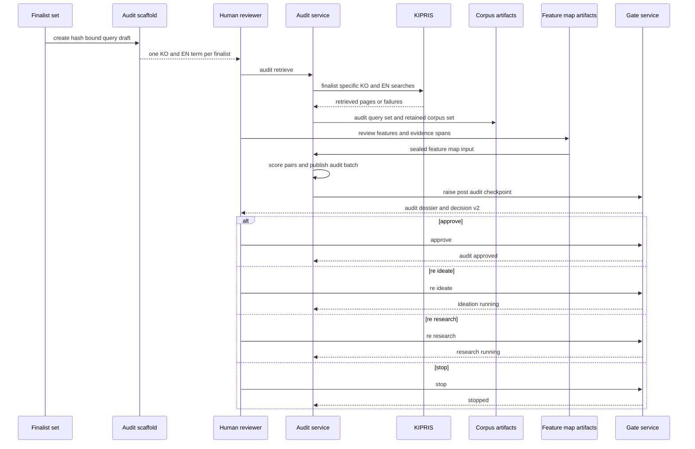

# Similarity Audit and Post-Audit Human Checkpoint

The final similarity audit is a **bounded research and review workflow**, not a patentability, novelty, inventive-step, validity, non-infringement, or freedom-to-operate determination. It compares each shortlisted finalist only against the evidence retained from that finalist's configured KIPRIS searches. Its outputs are therefore provisional research signals: they identify a closest observed reference, an uncertainty-aware upper risk, and gaps in the reviewed material that require human action.

This workflow begins after [ideation and finalist selection](/openwiki/workflows/ideation-and-finalist-selection.md) has produced a current `finalist_set`. It ends only after the post-audit decision has either approved drafting, directed rework, or stopped the run. For the shared mechanics of immutable artifacts, stale descendants, and gates, see [State and provenance kernel](/openwiki/architecture/state-and-provenance-kernel.md). For the network and credential rules, see [Research adapters and network egress](/openwiki/integrations/research-adapters-and-network-egress.md).

## End-to-end flow



The sequence shows the normal checkpoint route: a **clean** audit still reaches `post_audit_checkpoint`; it never silently transitions to drafting. A batch with no `decision_required` finalist but one or more `coverage_insufficient` finalists instead raises the separate `coverage` gate. If both appear, `decision_required` has routing precedence and the post-audit checkpoint contains every finalist, including the coverage-insufficient one.

## 1. Create and run the audit query set

### Hash-bound bilingual input

Generate, rather than hand-copy, the query bindings:

```bash
python3 -m patent_factory scaffold audit-query --run RUN --run-id ID --out workspace/requests/audit-query-input-v1.json
```

The scaffold reads the current finalist revision and produces `audit-query-input-v1` with its `finalist_set_hash`, one group per finalist, and `TODO(agent)` Korean (`ko`) and English (`en`) terms. The operator fills the terms. Retrieval rejects inputs unless the submitted hash is the current finalist-set hash, each finalist occurs exactly once, every term is nonempty, and each group contains both languages. Thus identical wording for two finalists is still two distinct finalist-bound query groups; it is not merged into a shared search.

Run a deterministic fixture pass or a live KIPRIS pass:

```bash
python3 -m patent_factory audit retrieve --run RUN --run-id ID --query-input workspace/requests/audit-query-input-v1.json --fixture-manifest documents/manifest.json --documents-root documents --workspace-root workspace --retrieved-at 2026-07-19T00:00:00Z
```

Use `--live` instead of `--fixture-manifest` only for the credentialed KIPRIS adapter. In either mode, the command creates an `audit_query_set` bound to the finalist set and `scorer_config`, advances from `finalists_ready` to `audit_running`, and records the retrieved query/evidence provenance. A completed, still-current corpus set bound to the same query-set revision is replayed without transport; a changed finalist set or scorer configuration invalidates the descendants and requires a fresh bound query/corpus chain.

### Egress and retrieval bounds

For each finalist-language term, `run_audit_retrieval` creates a KIPRIS `word_search` envelope with a finalist-specific `audit_binding`. Pagination uses the fixed SimRisk v1 limits: five pages, at most 100 results per query, and a constant 30-record KIPRIS page window. Retrieval failures are collected rather than represented as favorable no-hit results.

A live request first probes the adapter. If its credential is unavailable, retrieval suspends at a `credential` gate **before** an audit query artifact, scorer configuration, research query, or network request is written. A supplied credential decision must be current, unused, and bound to the exact finalist set and audit request; it is consumed only when that request starts. Credential canaries are rejected at the query-input and response boundaries so credentials cannot enter persisted audit data.

## 2. Construct the retained corpus

Each finalist receives one `retained-corpus-v1` entry in the persisted `corpus_set`. The builder:

1. Normalizes a patent identity from application number, publication number, original identifier, or source locator.
2. Deduplicates by normalized application identity plus evidence content hash, while preserving every logical query and page query that hit the retained record.
3. Sorts candidates by number of distinct logical-query hits descending, then best source rank, application identity, and content hash.
4. Retains the top 100, including all records tied at the 100th record's substantive boundary; records below that boundary and all query failures remain recorded with reasons.
5. Hashes the complete retained/excluded/failure payload as `corpus_hash`.

This preserves why a record was included or excluded, but it also defines an important limit: the audit sees only retained results from the supplied bilingual terms, retrieval budgets, and recorded responses. More retained references do not establish completeness of the global prior-art universe, and a small or failure-affected corpus should be treated as an evidence-coverage limitation rather than a low-risk conclusion.

## 3. Review, seal, and persist feature maps

### Request input versus durable artifact

`feature-map-set-input-v1` is an **author-filled request** to `audit score`; it is not itself the durable feature-map artifact. Generate a draft after retrieval:

```bash
python3 -m patent_factory scaffold feature-map --run RUN --run-id ID --out workspace/requests/feature-map-set-input-v1.json
```

The draft pre-fills only clerical material: current finalist and corpus hashes, classifications, candidate-span hashes derived from finalist fields, configured category weights, retained evidence IDs, inspected-field candidates, and available reference-span choices. It deliberately leaves the feature descriptions, reference decisions/rationales, selected reference spans, reviewer attestation, and `map_id` for human completion. In particular, a scaffold never asserts that review occurred.

A finished map has six feature categories—`problem`, `inputs`, `mechanism`, `transformations`, `outputs`, and `technical_effects`—and a review block with `status: "reviewed"`, `reviewed_by`, and `reviewed_at`. Its category weights must exactly match the fixed configuration. For every retained reference, the reviewer supplies one decision for every feature: `matched`, `different`, `not_disclosed`, or `unavailable`, with a nonempty rationale. `matched`, `different`, and `not_disclosed` require source-span evidence.

### Span-hash evidence review

The scorer does not accept arbitrary citations. Candidate feature spans must be hashes of the actual finalist fields appropriate to the feature category. A reference decision may select only field-span hashes belonging to that retained evidence revision, and its `inspected_fields` must be real, nonempty retained fields from `title`, `abstract`, or `classifications`. Further, each feature map must cover every retained record exactly once. These checks bind a human conclusion to the candidate and evidence revisions actually reviewed, rather than to copied text or a different record.

After completing all judgments, seal the request:

```bash
python3 -m patent_factory scaffold feature-map --seal workspace/requests/feature-map-set-input-v1.json --out workspace/requests/feature-map-set-input-v1.sealed.json
```

Sealing removes scaffold-only span-choice menus and derives each `fm_...` `map_id` from the canonicalized, filled map and finalist ID. It does not change a judgment. Any post-sealing edit to a status, rationale, span selection, or review attestation changes the identity, so the input must be sealed again. `audit score` requires exactly one unique, correctly sealed map for each current finalist.

Only after authoritative validation does scoring persist `feature-map-set-v1`. That artifact holds canonical maps plus the run ID, finalist-set hash, and corpus-set hash; the `audit_batch` subsequently binds its own `feature_map_set_hash` to it. Treat the request file as mutable pre-submission work and the persisted artifact as the reproducible, hash-bound audit input.

## 4. Score the retained evidence deterministically

### Fixed `simrisk-v1.0.0` configuration

`config/simrisk-v1.0.0.json` is deliberately not a tuning surface under the same version. The loader accepts only the canonical `simrisk-v1.0.0` weights, tokenizer, thresholds, corpus limit of 100, page cap of 5, and 100 results per query; a scoring change requires a version bump.

At pair level, text is normalized with NFKC and case folding, tokenized with `[0-9a-z가-힣]+`, and compared using token Jaccard and character-trigram Dice overlap. Title and abstract receive weights 0.25 and 0.75. Feature similarity is a reviewed weighted sum, with category totals `problem` 0.10, `inputs` 0.10, `mechanism` 0.30, `transformations` 0.20, `outputs` 0.10, and `technical_effects` 0.20. Classification similarity uses the best overlap level from exact subgroup through unrelated.

The observed risk is calculated as:

```text
r_obs = 100 × clamp(0.25 × T + 0.60 × F + 0.15 × C − 0.20 × D)
```

`D` is differentiation credit from essential features marked `different` or `not_disclosed`. `r_hi` uses a conservative upper treatment for unavailable text, features, and classifications. `Q` is the availability/coverage measure for the components that could actually be observed. Exact rational numerators and denominators accompany the rendered percentages; validation rejects a display, label, or summary that is inconsistent with those exact values.

The pair label uses observed-risk thresholds: `low` below 35, `moderate` from 35, `high` from 55, and `excessive` from 75. A score is therefore repeatable for the same sealed maps, retained corpus, and configuration, but it remains a provisional within-corpus research aid—not a legal conclusion.

### Candidate outcome and coverage

For a finalist, the audit stores both the reference with greatest observed risk (`closest_reference_id`) and the evidence reference producing the greatest upper risk (`upper_bound_reference_id`). Ties are deterministic. The outcome is:

| Condition | Finalist outcome | Meaning |
| --- | --- | --- |
| Any `r_obs` is at least 75 | `decision_required` | A reviewer must decide how to handle an observed excessive provisional similarity signal. |
| No observed excessive score, but maximum `r_hi` is at least 75 or its `Q` is below 80 | `coverage_insufficient` | The available/reviewed material is too incomplete to clear the finalist, even if the observed score is lower. |
| Neither condition | `audit_approved` | The finalist is clear under this fixed within-corpus heuristic, subject to the mandatory human checkpoint. |

An empty retained corpus yields zero coverage, observed risk zero, upper risk 100, and `coverage_insufficient`. In ordinary thin-coverage cases, the closest and upper-bound evidence IDs can still be meaningful and are included in the checkpoint dossier. Do not interpret a null closest reference as a global statement that nothing exists.

The durable `audit-batch-v1` contains at least three finalist results and binds `finalist_set_hash`, `corpus_set_hash`, `feature_map_set_hash`, `scorer_config_hash`, and `run_id`. Its validator recalculates labels and finalist summaries from pair scores before publication, preventing independently edited displays or outcome fields from drifting away from the reviewed evidence.

## 5. The post-audit checkpoint

### Why a clean result still stops

When any finalist is `decision_required`, **or when all are `audit_approved`**, scoring publishes the audit batch and raises `post_audit_checkpoint`, leaving the run in `decision_required`. The latter is the key invariant: a clean score still stops for a user-authored evaluation; it does not enter `audit_approved` automatically. Its approval scope binds the audit hash and the current finalist, corpus, feature-map, and configuration hashes, and carries a dossier row for **every** finalist with candidate/map/corpus identities, outcome, `r_obs`, `r_hi`, coverage, closest reference, upper-bound reference, and the fixed provisional counterargument.

The checkpoint decision uses `gate-decision-input-v2`, unlike legacy gates. Create a draft only for a pending checkpoint:

```bash
python3 -m patent_factory scaffold gate-decision --run RUN --run-id ID --gate-id GATE_ID --out workspace/requests/gate-decision-input-v2.json
```

The scaffold pre-fills immutable `gate_id`, subject hash, approval scope, finalists, and any structurally required `retain_with_warning` entry. It leaves the action, actor, reason, all per-finalist `interesting` and `boring` feedback, decision reasons, and conditional re-research plan as `TODO(agent)` fields. This is intentionally a user-authorship boundary: core validation rejects `TODO(agent)` anywhere in those fields, requires exactly one nonempty feedback entry for each current finalist, checks the approval scope against the current artifacts, and refuses stale bindings.

### Allowed outcomes

| Action | Required human input and validation | Next state |
| --- | --- | --- |
| `approve` | No coverage-insufficient finalist may remain. For a clean batch, `decisions` is empty. For every `decision_required` finalist, exactly one `retain_with_warning` rationale is required. | `audit_approved` |
| `re_ideate` | `decisions` and plan are empty; feedback for every finalist is still required. | `ideation_running` |
| `re_research` | `decisions` is empty; feedback for every finalist and a bounded, non-vacuous plan are required. The persisted resolution includes the plan and `plan_hash`. | `research_running` |
| `stop` | No partial finalist decision and no plan. | `stopped` |

The approval block is deliberate. A batch can contain both an excessive observed-risk finalist and a coverage-insufficient finalist; checkpoint routing chooses the checkpoint for that mixed batch, but approving only the excessive finalist would otherwise strand the coverage problem. The operator must choose `re_research` to broaden the evidence or `re_ideate` to replace/rework the candidate before an approval can proceed.

Resolve the authored request with:

```bash
python3 -m patent_factory gate decide --run RUN --run-id ID --gate-id GATE_ID --input workspace/requests/gate-decision-input-v2.json --workspace-root workspace
```

A successful approval is consumed and bound to the audit. The report workflow subsequently requires exactly one current, complete checkpoint approval for that audit and renders the checkpoint outcome, including warnings and feedback. Continue there with [report, review, validation, and sharing](/openwiki/workflows/report-review-validation-and-sharing.md).

## Rework and live re-research safeguards

`re_ideate` returns to ideation: reauthored candidates/finalists create a new lineage, and the prior audit descendants become stale rather than being overwritten. `re_research` returns to research with the user-authored bounded plan stored in the gate-resolution artifact. An offline manual-import second pass can add evidence without live egress.

A live, credential-requiring second pass has an additional safeguard. While a valid `re_research` anchor is active, the research runner derives its plan and `plan_hash`, salts the attempt identity, and force-raises a **fresh credential gate even if a credential is already present in the environment**. The approval scope shows the bounded plan and the literal second-pass terms, so the old first-pass credential approval cannot silently authorize new egress. A stale, missing, unbounded, or hash-mismatched re-research plan refuses live egress; a later `research_complete` cycle-back clears the re-entry anchor.

## Operational checks and failure semantics

- Read the pending scope before authoring a decision:

  ```bash
  python3 -m patent_factory gate inspect --run RUN --run-id ID --gate-id GATE_ID
  ```

- Inputs with stale finalist/corpus/configuration hashes, duplicate groups/maps, unreviewed retained records, invalid span hashes, inconsistent exact scores, or unsupported state transitions fail before publishing the audit artifacts.
- Audit retrieval and scoring are idempotent only for the exact bound inputs. A completed scoring replay must match the stored canonical maps, hashes, and scorer configuration; otherwise it fails rather than substituting new judgments into an old result.
- Audit and decision exports are created only under safe non-symlink run/export directories with private permissions. Do not use export files to bypass a pending gate.
- Fixture retrieval is the preferred deterministic test/operation mode. Live KIPRIS retrieval is a bounded credentialed egress path, not a fallback that may be invoked merely because a fixture is absent.

## Focused verification coverage

The integration suite exercises the load-bearing boundaries rather than only score arithmetic:

- `tests/integration/test_g005_audit.py` proves bilingual per-finalist query separation, pre-egress credential suspension, response-canary rejection, config/finalist invalidation, deterministic corpus/audit persistence, span validation, sealing, schema validation, and exact replay behavior.
- `tests/integration/test_g006_decisions.py` verifies stale approval bindings fail closed, policy-selected target states cannot be caller-forged, bounded coverage plans are required, and concurrent gate decisions produce one durable winner plus an idempotent replay.
- `tests/integration/test_g010_checkpoint.py` follows the real finalist-to-report journey for clean, breaching, mixed-coverage, re-ideate, re-research, stop, user-authored feedback, and fresh live-second-pass credential-gate cases. It also asserts the CLI contract that a clean `audit score` returns a pending checkpoint rather than silently approving.

For the evidence model before finalist selection, see [research and evidence intake](/openwiki/workflows/research-and-evidence-intake.md). For CLI containment, request scaffolds, and private-workspace conventions, see [CLI, private workspace, and scaffolds](/openwiki/operations/cli-private-workspace-and-scaffolds.md).
